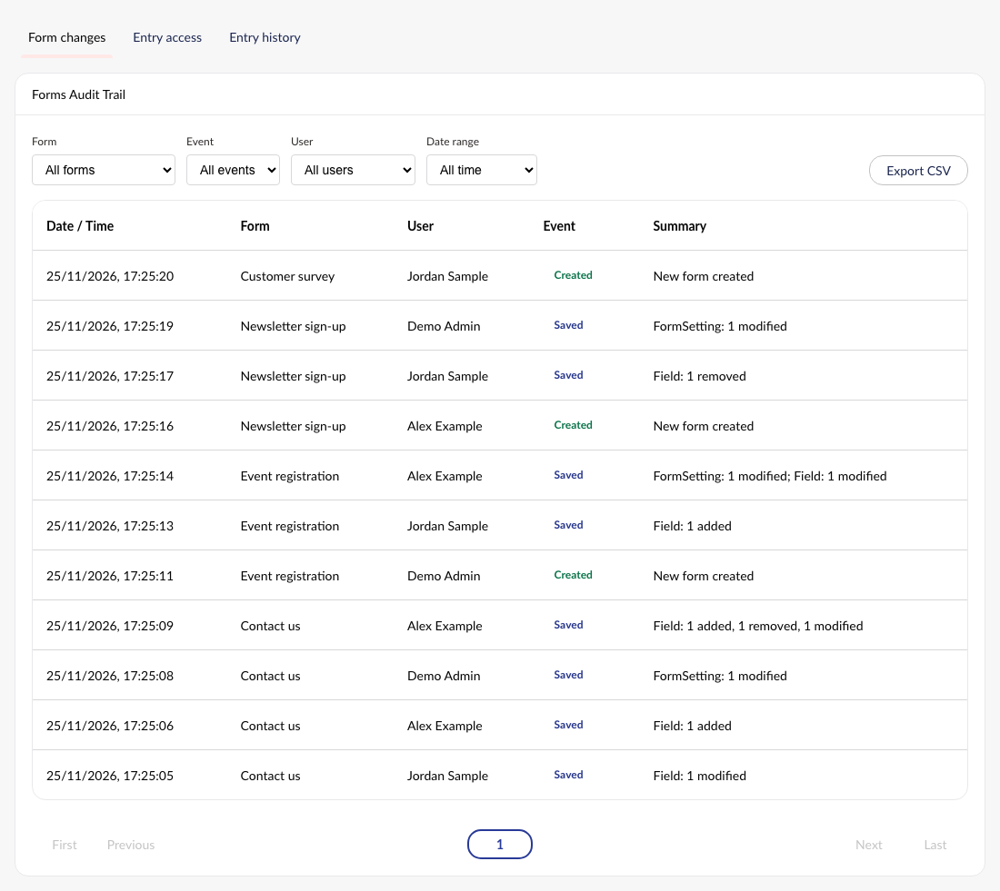

# Umbraco.Community.FormsAuditTrail

[](https://www.nuget.org/packages/Umbraco.Community.FormsAuditTrail)
[](https://www.nuget.org/packages/Umbraco.Community.FormsAuditTrail)
[](https://github.com/PascalA94/Umbraco.Community.FormsAuditTrail/blob/main/LICENSE)

A community package, not made or supported by Umbraco HQ. Requires Umbraco 18.3+ with Umbraco Forms 18.2.2+ (package 18.x), or Umbraco 17.7+ with Umbraco Forms 17.5.2+ (package 17.x), on .NET 10.

## Forms Audit Trail: who touched your form data

This package keeps two records in one backoffice dashboard.

- **Entry access audit.** Who viewed, opened, edited, deleted and exported form entries in the backoffice, and who opened an uploaded file. Entries hold the data your visitors typed into your forms, so this is the record of which staff handled it.
- **Form design audit.** Who changed a form's fields, pages, workflows and settings, with field-level diffs.

Both are view-only. The package never changes, blocks or rolls back anything in Forms, unless you switch on `FailClosedOnExport`, which can refuse an export (see [Configuration](#configuration)).



### What is recorded

- Each time someone opens a form's entries list, with the filter, page and number of rows shown.
- Each time someone opens one entry.
- Each edit to an entry, as one row per changed field with the before and after value (see [Edit values](#edit-values)).
- Each entry deletion: a single delete, a bulk delete and a permanent form delete.
- Each export that Forms generates, and each download of the generated file.
- Each time someone opens an uploaded file.
- Each workflow re-run on an entry, each entry created in the backoffice, and each member lookup ("which forms has this member submitted to").
- Reading the log itself: opening an entry's history, searching it by user or entry, and exporting it.
- Changes to this package's own settings, and gaps where the audit could not write.

Every row holds the time, the backoffice user (name and key), the form and, where it applies, the entry id.

### What is never recorded

- Field values, except in edit rows, and only as the [edit values setting](#edit-values) allows.
- Free-text search terms, unless you switch on `CaptureSearchTerms`. The row only notes that a search was run.
- Uploaded file names. A hash of the file path is stored instead.
- Member email addresses or other free-text member identifiers. A member lookup stores the member key only when it is a GUID or a number.
- Entry ids for list views, unless you switch on `LogListRecordIds`.
- Front-end submissions. A visitor submitting a form is not staff activity and is out of scope.
- Edit values in the access-log CSV. They stay in the backoffice.

The full list of what the audit does not see is under [What is not captured](#what-is-not-captured).

## Compared with Forms' built-in history

Umbraco Forms 18.2 added its own form history. It saves a version every time a form is saved, lists the history on each form's Info tab, and can roll a form back to an earlier version. Before 18.2, Forms kept no history of design changes. Forms keeps no record of who looked at or exported entries, so the entry access audit has no Forms equivalent.

For design changes the two cover different needs:

| | Forms 18.2+ history | This package |
|---|---|---|
| Where it appears | The Info tab of each form | One dashboard in the Forms section, covering every form |
| What a change shows | The saved version as raw JSON | Field-level changes: added, removed, moved or modified |
| Finding changes | A list per form, newest first | Filters by form, event type, user and date range |
| Export | None documented | CSV, following the active filters |
| Rollback | Yes | No, the package is view-only |
| Moving to the recycle bin and restoring | Recorded | Not recorded |
| After a form is permanently deleted | Its saved versions are deleted with it | Its audit history is kept |
| Retention | Version cleanup, off by default (`Umbraco:Forms:Options:FormVersionCleanup`) | `RetentionDays`, off by default |

They work side by side. Use Forms' history to roll a form back, and this package to see who changed what across all your forms, to export that for a review, or to keep a record of forms that have since been deleted.

## Compatibility

| Package version | Branch | Umbraco CMS | Umbraco Forms | .NET | Database |
|---|---|---|---|---|---|
| 18.1.0 and later | `main` | 18.3.0+ | 18.2.2+ | 10 | SQLite and SQL Server (including Umbraco Cloud) |
| 17.x | `v17` | 17.7+ | 17.5.2+ | 10 | SQLite and SQL Server (including Umbraco Cloud) |

The entry access audit is part of 18.1.0 and later. The 17.x line carries the design audit only, until the entry audit is released there.

### Versioning

The package's major version matches the Umbraco major it targets. `18.x` is for Umbraco 18 and is developed on `main`. `17.x` is for Umbraco 17 and is maintained on the `v17` branch, which still receives fixes.

The first release, `1.0.0`, targeted Umbraco 17 before this scheme existed. It is deprecated on NuGet, so Umbraco 17 sites should use `17.x` instead.

## Installation

```bash
# Umbraco 18
dotnet add package Umbraco.Community.FormsAuditTrail

# Umbraco 17 - pin a 17.x version, otherwise the latest (18.x) is selected and restore fails
dotnet add package Umbraco.Community.FormsAuditTrail --version 17.0.5
```

The package registers itself through an `IComposer` and creates its database tables on startup. The dashboard appears as an **Audit** tab in the Forms section of the backoffice. Its first sub-tab, **Form changes**, is the design audit. **Entry access** and **Entry history** are the entry audit, and only users in an access-log group see them.

## Upgrading from 18.0.x

**Entry auditing is on after you upgrade.** It changes what your site records about your staff, so read [GDPR](#gdpr) before you deploy.

1. **Tell the people who need to know.** Entry auditing records who views, edits, exports and deletes form entries, and who opens uploaded files. Update your record of processing activities (ROPA), your staff privacy notice and your DPIA screening. To turn it off, set `FormsAuditTrail:EntryAudit:Enabled` to `false`. That change is itself recorded.
2. **Check your versions.** 18.1.0 raises the floors to Umbraco CMS 18.3.0 and Umbraco Forms 18.2.2. Upgrade those first if you are behind. The Forms releases involved are security releases.
3. **Decide who reads the log.** Only the `admin` group can read the access log by default. Change it with `EntryAudit:AccessLogUserGroups`.
4. **Know the defaults.** Access rows are kept for 365 days and changed values for 90. Sensitive fields are masked. A field that an edit blanks keeps no old value, and its earlier stored values for that entry are removed too.
5. **Check database rights.** Four new tables are created on first start, so the database user needs permission to create tables once. Your existing history is untouched.
6. **Find the dashboard.** The tab is now called **Audit**. The existing view is under **Form changes**, and the alias and address are unchanged, so bookmarks still work.
7. **Downgrading.** Version 18.0.x ignores the new tables and leaves them behind. See [Removing the entry audit tables](#removing-the-entry-audit-tables) if you want them gone.

Access-log users also see a dismissible notice in the dashboard after the upgrade that links here. Dismissing it is remembered in that user's browser only.

## Entry access audit

Open **Forms > Audit > Entry access** to see the log. Each row has the time, user, event, form, entry and a detail column. Filter by form, user, event, date range or entry id, page through the results and export CSV.

### Events

| Event | Written when | Notes |
|---|---|---|
| `ListViewed` | A user opens an entries list, changes page or changes filter | Stores the filter, page and row count. Entry ids only with `LogListRecordIds`, up to 500 per row |
| `DetailViewed` | A user opens one entry | |
| `Edited` | A backoffice edit saves successfully and changes at least one field | One child row per changed field. Approving, rejecting or a state change writes nothing |
| `Created` | A user creates an entry in the backoffice | Field captions only, no values |
| `Deleted` | A single delete, a bulk delete, or a permanent form delete | Only entries that Forms confirmed deleting in that request are recorded. Bulk deletes hold those entry ids as child rows. If Forms confirmed none, the row says 0 entries, `recordIdsCaptured: false` and the number requested (`requestedCount`), and nothing is scrubbed. A form delete records how many entries it removed, when Forms says |
| `Exported` | Forms generates an export | Holds the export type, file name and the entry ids it contained |
| `ExportDownloaded` | A user downloads a generated export | Linked to its `Exported` row |
| `FileViewed` | A user opens an uploaded file | Hash of the file path only |
| `WorkflowRetried` | A user re-runs a workflow on an entry | Never deduplicated, because it can send data out by email or webhook |
| `MemberSummaryViewed` | A user looks up which forms a member submitted to | |
| `AuditViewed`, `AuditSearched`, `AuditExported` | A user reads the log itself | See [Reading the log is logged](#reading-the-log-is-logged) |
| `ConfigChanged` | An `EntryAudit` setting changes, including a restart with changed settings | Written even when auditing is off |
| `AuditGap` | The first successful write after one or more failed writes | Count, first and last failure time, and the event types missed |

Failed requests write nothing: an edit that returns an error is not recorded as an edit.

A repeat of the same view by the same user inside `DeduplicateSeconds` is written once. This applies to list views, opens, file opens, member lookups and reading the log. Edits, deletes, exports, downloads, workflow re-runs, creations, config changes and gaps are never deduplicated. Each server in a load-balanced site deduplicates for itself.

### Edit values

`EntryAudit:StoreEditValues` decides what an `Edited` row keeps for each changed field.

- `None`: the field id and caption only. Both values are empty.
- `MaskSensitive` (default): values are stored, except for fields marked "contains sensitive data" in Forms. Those are stored as `[masked]` and the real value never reaches the database.
- `All`: every value is stored as typed, sensitive fields included. These are then readable by anyone with access to the database or a backup. In the dashboard, a sensitive value is still shown only to users in Umbraco's built-in Sensitive data user group, because the read side masks too.

The dashboard masks again when it reads. A stored value shows as `[masked]` if the field is marked sensitive now (it may have been flagged after the edit), if the field has since been deleted, or if the form cannot be loaded. Only a user in Umbraco's built-in Sensitive data user group sees past those three cases. Values of fields that are known and not sensitive show to every user who can open the row. Nobody sees past a value that was masked when it was written, because it was never stored.

When an edit empties a field, the row says "Value cleared" and keeps who, when and which field, but not the old value. The earlier stored values of that field for the same entry are removed as well, so clearing a field erases its history in this log. Set `KeepClearedValues` to `true` to keep the old value and that history, under the same masking rules. Switching it back to `false` applies to the past too: the daily job's `clearedValueSweep` step removes the earlier stored values of every field that was later cleared, including values kept while the setting was on. The old value stored on the clearing edit itself while the setting was on is not swept; it goes when the edit values expire (`EditValueRetentionDays`) or the entry is deleted.

Old and new values are removed after `EditValueRetentionDays` (default 90). The row stays and shows "Value removed on (date)". They are also removed when Forms confirms the entry is deleted (see [Scrub lag](#gdpr)).

An edit is compared against the entry as Forms itself reads it, not against the raw database row. If another package encrypts or transforms entry values on the way in and out of the database, the audit sees the values as Forms does, and then stores edit values in its own tables without that protection. The dashboard shows a notice when it finds another package that handles entry values, and you should consider setting `StoreEditValues` to `None`. The check looks at notification handlers only. A decorated `IRecordStorage` or database-level encryption is not detected, so do not rely on the notice being complete.

### Reading the log is logged

- Exporting the access log writes an `AuditExported` row.
- Opening an entry's history writes an `AuditViewed` row.
- Opening an `Edited` row whose values have not yet been removed writes an `AuditViewed` row.
- Searching the log by user or by entry id writes an `AuditSearched` row. Other filters (form, event, dates) are browsing and are not logged.

This lets you answer "who has been looking at Jane's entry?" and shows who looked at the log.

### Entry history

Enter an entry id on the **Entry history** tab, or click an entry id in **Entry access**, to see that entry's whole timeline: list views (only if `LogListRecordIds` is on), opens, edits, deletions, the exports that contained it, downloads of those exports and opens of its uploaded files. History is capped at 1,000 rows and the dashboard says when it has been cut short. File opens are matched to the entry at read time, by hashing the entry's own upload values, and only the most recent 50,000 `FileViewed` rows are scanned, so very old opens may not appear.

### Access-log CSV

The CSV has the columns `Id, Timestamp, Event, FormId, FormName, UserKey, UserName, RecordId, RecordCount, Detail`. Edit values are never in it, and a captured search term is removed. Every text cell is protected against spreadsheet formula injection. The file streams as it is read and stops at 100,000 rows with a final line saying so, so narrow the filter if you hit it. Only one access-log export per user can run at a time, per server instance, and a second one gets a 429. Switch it off with `FormsAuditTrail:EntryAudit:EnableCsvExport`.

## Configuration

No configuration is required. This is every setting, with its default:

```json
{
  "FormsAuditTrail": {
    "RetentionDays": 0,
    "EnableCsvExport": true,
    "EntryAudit": {
      "Enabled": true,
      "LogListViews": true,
      "LogListRecordIds": false,
      "DeduplicateSeconds": 60,
      "StoreEditValues": "MaskSensitive",
      "RetentionDays": 365,
      "EditValueRetentionDays": 90,
      "CaptureSearchTerms": false,
      "AccessLogUserGroups": [ "admin" ],
      "KeepClearedValues": false,
      "FailClosedOnExport": false,
      "EmitLogEvents": false,
      "EmitLogEventRecordIds": false
    }
  }
}
```

| Key | Default | What it does |
|---|---|---|
| `RetentionDays` | `0` | Design audit. A daily job deletes entries older than this many days. `0` keeps them forever |
| `EnableCsvExport` | `true` | Set to `false` to turn off the design-audit CSV endpoint and hide its button. Also the default for `EntryAudit:EnableCsvExport` |
| `EntryAudit:Enabled` | `true` | Master switch for writing access rows. Existing rows stay readable and retention still runs. Changes to the settings are still recorded |
| `EntryAudit:LogListViews` | `true` | Write a row when someone views an entries list |
| `EntryAudit:LogListRecordIds` | `false` | Store the entry ids shown on each list page, up to 500 per row. Off, a list view stores a count |
| `EntryAudit:DeduplicateSeconds` | `60` | Window for suppressing repeat views. `0` turns it off |
| `EntryAudit:StoreEditValues` | `MaskSensitive` | `None`, `MaskSensitive` or `All`. See [Edit values](#edit-values) |
| `EntryAudit:RetentionDays` | `365` | Days to keep access rows. `0` keeps them forever, and the dashboard says so |
| `EntryAudit:EditValueRetentionDays` | `90` | Days before stored edit values are removed. `0` never removes them by age. Erasure still removes them |
| `EntryAudit:CaptureSearchTerms` | `false` | Store the free-text search term used on an entries list or in the log. Off, only the fact of a search is kept |
| `EntryAudit:AccessLogUserGroups` | `["admin"]` | Aliases of the user groups that can read the access log. See [Permissions](#permissions) |
| `EntryAudit:KeepClearedValues` | `false` | Keep the old value when an edit empties a field |
| `EntryAudit:FailClosedOnExport` | `false` | When `true`, a Forms export or download, or an access-log CSV, is refused with a 503 if its audit row cannot be written. Off, the export goes ahead and the failure is logged. This is the only setting that can refuse an export. The package also answers 429 to a second concurrent access-log export by the same user, and 404 when the CSV is disabled |
| `EntryAudit:EnableCsvExport` | follows `EnableCsvExport` | Controls the access-log CSV only, so you can allow design CSVs without allowing staff-activity CSVs |
| `EntryAudit:EmitLogEvents` | `false` | Write one log event per access row, as an independent copy. See [Not tamper-evident](#not-tamper-evident) |
| `EntryAudit:EmitLogEventRecordIds` | `false` | Include entry ids in those log events |

Notes:

- A negative `EntryAudit` number stops the site starting, with the key named in the error. A negative top-level `RetentionDays` is treated as `0` with a warning, so existing installs still start.
- Changes apply without a restart, and each one writes a `ConfigChanged` row with the old and new values and the name of the server. The recorded settings hold no secrets. For the access-log CSV the row records the effective setting, so changing the top-level `EnableCsvExport` while the nested one is unset is recorded.
- `AccessLogUserGroups` is a list of group aliases, not names. Set in appsettings it replaces the default: `["editors"]` means only `editors`, not `admin` as well.
- `RetentionDays` and `EditValueRetentionDays` have no lower limit, because a short period can be a lawful choice. The job logs a warning when one run deletes more than 1,000 access rows, which is what a mistyped setting looks like.

## Permissions

The dashboard and its API require backoffice access to the Forms section. The package also honours Umbraco Forms' own per-form security, so users only see audit history for forms they can access. For a *deleted* form, the check uses whatever Forms' security records hold for that form id, which usually means only users with broad Forms access see its history.

**Reading the access log.** The **Entry access** and **Entry history** tabs, and every access-log endpoint, are limited to users in a group listed in `FormsAuditTrail:EntryAudit:AccessLogUserGroups`. Everyone else gets a 403 from the API and does not see the tabs.

- The check is on group aliases and ignores case. `admin` is the alias of Umbraco's Administrators group.
- If the list is empty or absent, it falls back to `admin`. To let nobody read the log, set it to `[""]`.
- A user who cannot be resolved, or who is locked out or not approved, is refused.
- The package logs a warning at start-up, and when the setting changes, for each alias that matches no user group.
- **Anyone who can edit user groups can read the log.** A listed alias that does not exist yet can be created later by whoever has access to the Users section and given to any user. Treat Users-section access as equal to admin for this log.

**Per-form limits still apply inside the log.** A user only gets rows for forms they can access. Asking for an inaccessible form's rows returns 403, and an inaccessible single row or entry history returns 404, so ids cannot be probed. Some rows belong to no single form: a form that could not be resolved, a member lookup, a settings change, an unfiltered log export and an audit gap. Rows of a form that no longer exists, including a form in the recycle bin, are treated the same way. Those are shown only to users who can access every form, and the check for "every form" includes forms in the recycle bin.

**Sensitive data.** A user in Umbraco's built-in Sensitive data user group can see stored edit values of sensitive fields, including fields deleted after the edit. A user without it sees `[masked]`.

The same applies to a form that has been permanently deleted: Forms can no longer say which of its fields were sensitive, so the access log lifts masking for the rows of a deleted form, and a user with that permission sees their stored values.

**What other Forms users can see.** Any user with access to the Forms section can read the dashboard's settings call. It tells them whether entry auditing is on, how long access rows and edit values are kept, and whether the access-log CSV is enabled. The dashboard shows retention to anyone who can open it. It does not list who is in the access-log groups, and health and off-period details are returned only to access-log users.

**Load-balanced sites.** Servers share one record of the last settings, and each `ConfigChanged` row names the server that wrote it. Servers with different settings can each write a row when they restart. Retention and erasure clean-up runs on the scheduling server only.

**System and Unknown.** Changes made with no backoffice user, such as Umbraco Deploy transfers or saves from code, are recorded with the user shown as **System**. A backoffice request whose user cannot be resolved is recorded as **Unknown**, never as System. The stored name is a copy taken at the time. The key is the evidence: the dashboard shows the user's current name beside the stored one when they differ, and the CSV carries the key.

## GDPR

This section is guidance for site owners and data protection officers. It is not legal advice, and the package cannot decide anything on your behalf. Have your DPO review it against your own situation.

The access log is personal data. It records the identity of your staff and what they did, and edit values can hold a data subject's own data. Because entry auditing is on by default, installing or upgrading to 18.1.0 starts systematic recording of staff activity. Work through this list before you deploy.

- **Lawful basis.** Pick and document one. It is usually legitimate interests (Article 6(1)(f)) with a written legitimate-interests assessment, or the security obligation in Article 32.
- **Staff privacy notice.** Update it (Article 13) to say that entry activity is recorded, what is recorded and how long it is kept.
- **Staff subject access requests.** Staff can ask for their own activity in this log. Filter the Entry access tab by that user, or export the CSV. Searching by user is itself logged.
- **DPIA.** Screen for one. Monitoring of employees often appears on supervisory authorities' lists of processing likely to be high risk.
- **ROPA.** Record both retention periods (`EntryAudit:RetentionDays` and `EditValueRetentionDays`) and the reason for each.
- **Retention.** Access rows are deleted after `EntryAudit:RetentionDays` (default 365) and changed values are removed after `EditValueRetentionDays` (default 90), by the daily job. Setting either to `0` keeps data for longer, and the dashboard banner says "kept indefinitely".
- **Erasure.** When an entry is deleted from Forms, the package removes the old and new values it stored for that entry. It keeps who, when and which field. Whether you may keep that after an erasure request is your DPO's decision. The package assumes you can, and that reading is unverified.
- **Scrub lag.** The scrub is immediate in some cases and delayed in the rest.
  - Deleting one entry or many from the backoffice entries screens is scrubbed in the same request, but only for entries Forms confirmed deleting in that request. If Forms confirmed none, nothing is scrubbed. If a bulk delete fails partway, the daily job scrubs the rest.
  - Permanently deleting a form scrubs the stored values of its entries that no longer exist, at once. Any that still exist wait for the daily job.
  - For all deletes made outside the backoffice, such as code calling Forms, or Forms' scheduled record deletion, the daily job scrubs them up to 24 hours later.
  - Emptying the Forms recycle bin is unconfirmed. It may scrub at once or wait, and the daily job is the safety net.
  - While `EntryAudit:Enabled` is `false`, a backoffice entry delete does no in-request scrub, so it waits for the daily job, up to 24 hours. Permanent form deletes still scrub at once, subject to the same rule that only entries that no longer exist are scrubbed.
  - If the daily job cannot run, because the scheduling server is down or a step fails, the lag lasts until it does. The dashboard banner reports a job that has not run in 48 hours or a step that failed.
- **Erasure by clearing fields.** With `KeepClearedValues` off (the default), clearing a field removes its old value and its earlier stored values for that entry. With it on, that history is kept. Where you can, erase by deleting the entry.
- **Backups.** Scrubbing and retention do not reach database backups.
- **Upload path hashes.** `FileViewed` rows hold an unsalted SHA-256 hash of the file's path inside the upload folder, in lower case. Anyone who knows or can guess a path can compute the same hash and check it. Treat the hash as pseudonymous personal data, not anonymous data. Erasure does not remove it: `FileViewed` rows keep the hash until the access-row retention ends. Only the match between the hash and the entry's file disappears once the entry is gone.
- **`StoreEditValues` set to `All`.** Sensitive values are then stored unmasked in your database and backups, and shown to users in the Sensitive data group. Document it.
- **Not tamper-evident.** See below.
- **Not complete.** The audit records backoffice activity through Forms' own screens. See [What is not captured](#what-is-not-captured).

## Not tamper-evident

The log lives in your site database. Anyone with database access, including an administrator with the right credentials, can change or delete rows without leaving a mark. The package does not sign or chain rows.

For an independent copy, set `EntryAudit:EmitLogEvents` to `true`. The package then writes one structured log event per access row, naming the row id, event, form, user and record count, and never values. Add `EmitLogEventRecordIds` to include entry ids. Ship those logs somewhere your database administrators cannot edit them.

## What is not captured

The entry audit records backoffice activity that goes through Forms' management API and Forms' upload middleware. It does not see:

- changes made by code, including your own code calling Forms' services, and anything done by workflows;
- the Umbraco Delivery API;
- changes made directly in the database;
- front-end submissions;
- Forms' Examine index and any search you run against it;
- exports from some exporters. Forms' "uploaded files in disk structure" exporter walks the upload folder directly and ignores the filter, so the `Exported` row is written but cannot list the entries it contained. The row is marked "ids not captured" and entry history says so;
- list views do not store entry ids unless `LogListRecordIds` is on, so entry history will not show who merely saw an entry in a list;
- anything on a Forms endpoint listed below.

Every public type in Forms' record, export, member and media API namespaces is either audited or on this list with the reason. A test in this package's CI fails when a Forms release it builds against adds a type that is in neither. It runs against the Forms versions the package is built with, not the version a site installs, so check this list again after a Forms upgrade.

| Forms type | Why it is not audited |
|---|---|
| `GetMetadataController` | Returns the entry count and last submitted date only |
| `GetWorkflowAuditTrailController` | Returns workflow run status only, no field values or record ids |
| `GetPageNumberController` | Returns a page number only. It takes a record id but returns none |
| `GetRecordSetActionCollectionController` | Returns the list of available record-set actions |
| `GetByPathMediarController` | Reads CMS media only and cannot reach Forms uploads (the spelling is Forms') |
| `GetLinkableMemberPropertiesController` | Returns member type property names only |
| `GetExportTypesController` | Returns the list of exporters only |
| `RecordControllerBase`, `GetRecordsControllerBase`, `MediaControllerBase` | Abstract base classes, not endpoints |
| `GenerateExportResponseModel`, `LinkableMemberProperty`, `MemberFormSummary` | Response models, not endpoints |

The dashboard carries the same warning under its tables.

### Uploaded files

Opening an uploaded file is recorded as a `FileViewed` row that holds a hash of the file's path, never the file name, because upload names often contain the data subject's name. A repeat open inside the dedupe window is one row, and range or cached requests of the same open do not add rows beyond that. The audit watches the same `/media/forms/upload/` path that Umbraco Forms itself protects, and Forms hard-codes that path. If your site moves `UmbracoMediaPath`, Forms may not protect uploads at all and this package does not see them either. With `Umbraco:Forms:Security:DisableFileUploadAccessProtection` switched on, Forms checks nothing, so a file opened without a backoffice sign-in is recorded against an Unknown user. A file opened on an expired backoffice session is still attributed to that user and marked `sessionExpired`. The `DisableFileUploadAccessProtection` and non-default `UmbracoMediaPath` cases are described from Forms' behaviour and were not run live.

## Operations

- **Database rights.** The package creates four tables on first start (`formsAuditTrailAccess`, `formsAuditTrailAccessRecords`, `formsAuditTrailEntryChanges` and `formsAuditTrailState`). The database user needs permission to create tables for that start. If the migration fails the site keeps running, the entry audit cannot write, and the dashboard shows a health banner saying migrations are pending.
- **Failure never blocks Forms.** If an audit write fails, the Forms action still succeeds and the failure is logged at Error level with the user, event, form and record count. The next successful write adds an `AuditGap` row. The one exception is the opt-in `FailClosedOnExport`.
- **Row sizes.** Names and captions are cut to fit their columns, and each row's detail is capped at 8 KB, with `truncated` set when something was dropped. A row is written even when the form could not be identified. It is then stored against an empty form id, and shown only to users who can access every form.
- **Daily job.** One job runs every 24 hours (first run five minutes after start) on the single or scheduling server. It applies the retention periods and runs the erasure check that scrubs values for entries that no longer exist. That check reads entry ids only, never entry data. If it cannot read them, it scrubs nothing and the step is reported as failed.

### The health banner

Access-log users see a red banner above the tabs when something may have stopped the audit recording. It names the reasons:

| Banner text | Meaning |
|---|---|
| N writes failed since (time) | Audit writes failed on this server since it started and have not yet been followed by a successful one |
| database migrations are pending | The package's tables are missing or out of date, often a database user without permission to create them |
| the daily retention and erasure job has not run in 48 hours | No server has completed the daily job. Retention and erasure are not running |
| a step of the daily retention and erasure job failed | One step failed on its last run. See the server log |

Limits of the banner:

- It reports whether writes are working now, per server. After a failure, it clears once a later write succeeds. The `AuditGap` row and any `recordIdsCaptured: false` flag stay as the lasting evidence.
- If an export or list view writes its row but fails to store some of the entry ids, the row is kept and flagged `recordIdsCaptured: false`, and the failure is recorded as a gap. The banner can clear straight away, because the row itself was written.
- For a very short moment while the package stores a gap row, the banner can read as healthy, and it turns red again if that row then fails to store.
- Failure counts are held in memory and restart at zero.
- Changes to settings are recorded the same way. If the database is down when someone switches auditing off, the record waits in memory and is retried. The queue holds at most 100 changes and drops the oldest with an Error log. A restart while the database is unavailable can lose or shorten a recorded switch-off period, and the Error log written at shutdown is then the only trace. Where the database is healthy, a switch-off appears as an "Entry auditing was off from (time) to (time)" banner for as long as the row is within retention.

### Removing the entry audit tables

The entry audit tables are not removed when you uninstall the package or downgrade to 18.0.x. They hold personal data, so you may want them gone. The script is manual. Nothing in the package runs it.

**Export the access log first. Dropping these tables deletes a record your ROPA may rely on.** Take a database backup too. Run the script with the package uninstalled or the site stopped.

<!-- drop-script:start -->
```sql
DROP TABLE IF EXISTS [formsAuditTrailAccessRecords];
DROP TABLE IF EXISTS [formsAuditTrailEntryChanges];
DROP TABLE IF EXISTS [formsAuditTrailAccess];
DROP TABLE IF EXISTS [formsAuditTrailState];
DELETE FROM [formsAuditTrailMigrationsHistory] WHERE [MigrationId] LIKE '%AddEntryAccessAudit';
```
<!-- drop-script:end -->

It is written for both SQLite and SQL Server. It was run against a SQLite copy of the schema only; it has not been run on SQL Server. It leaves the design audit tables (`formsAuditTrailEntries`, `formsAuditTrailChanges`) and the first migration's history row alone. If you install 18.1.0 or later again, the migration runs and recreates the four tables.

## Form design audit

### Features

- Captures form create, save and delete events
- Field-level diffs showing which fields were added, removed, moved or modified
- Tracks workflows being added or removed, and changes to their settings
- Tracks page-level changes
- Groups change details by category (Field, FieldSet, Page, Workflow, FormSetting)
- Filters by form, event type, user and date range, with Today, 7 days and 30 days presets
- CSV export that respects the active filters, is hardened against spreadsheet formula injection, and can be turned off in config
- Paginated audit table
- Raw JSON viewer for the before and after snapshots
- Honours Umbraco Forms' per-form user permissions
- Optional retention policy that deletes old entries automatically

### How it works

The package handles the Umbraco Forms notifications `FormSavingNotification`, `FormSavedNotification` and `FormDeletingNotification`, and takes a snapshot of the form before and after each save. It computes a diff between the two snapshots and stores it with the audit entry.

For entries, a global MVC action filter recognises Forms' backoffice entry controllers and writes the access row after the action succeeds. Before an edit it reads the entry through Forms' own storage, so any decrypting hook on your site runs first. Upload opens are recorded by a small middleware placed just in front of Forms' own upload protection.

Audit data lives in the main Umbraco database and is accessed through EF Core. The package has separate migrations for SQLite and SQL Server and picks the right set from your Umbraco connection string. It applies them on startup, except while Umbraco is installing or upgrading.

### Database

The package creates these tables in the Umbraco database:

- `formsAuditTrailEntries`: one row per form create, save or delete event, including the JSON snapshots
- `formsAuditTrailChanges`: one row per field-level change within an entry
- `formsAuditTrailAccess`: one row per entry access event
- `formsAuditTrailAccessRecords`: the entry ids behind an export, bulk delete or (optionally) list view
- `formsAuditTrailEntryChanges`: one row per field changed in an entry edit
- `formsAuditTrailState`: a small key-value store for the daily job's last run (the outcome of each step: `definitionRetention`, `accessRetention`, `valueExpiry`, `reconciliation`, `clearedValueSweep`) and the last recorded settings
- `formsAuditTrailMigrationsHistory`: the package's own EF Core migrations history

`Timestamp`, `FormId`, `UserKey` and `RecordId` are indexed to keep filtering fast.

### The HTTP API

The dashboard talks to endpoints under `/umbraco/formsaudit/api/v1/`. The design-audit routes keep their shape from earlier versions. The access log adds `access`, `access/{id}`, `access/records/{recordId}`, `access/forms`, `access/users` and `access/export`, and the `config` response gains extra fields. All of them need the Forms section policy, and the `access` routes also need the access-log group. They exist for the dashboard. The CSV export reads in keyset-paginated batches, which has not been verified on SQL Server.

## Known limitations

- Workflow property changes (renames, settings edits, or toggling a workflow active in the workflow dialog) are captured on the *next* form save, not when they happen. Umbraco Forms writes workflows to the database before it fires form notifications. Workflow additions and removals are captured correctly.
- Moving a form to the Forms recycle bin and restoring it are not recorded, because Forms raises no notifications for either. Permanently deleting a form is recorded.
- A rollback (Forms 18.2 and later) appears as a normal `Saved` entry, not one labelled as a rollback.
- Form copies are recorded as `Created` events, because Umbraco Forms 18 has no copy notification.
- Umbraco Deploy transfers are recorded but attributed to **System**, not to the user who ran the deployment, because the notification doesn't include the deploying user.
- If two people edit the same entry at the same time, an entry's edit history can show an old value that the other person had already changed. Umbraco Forms itself keeps whichever save lands last.
- The entry audit is not complete and not tamper-evident. See [What is not captured](#what-is-not-captured) and [Not tamper-evident](#not-tamper-evident).

### SQLite on busy sites

On SQLite, deleting entries from the Forms entries screen, whether one entry or many, can hang if another request writes to the database at the same time. This comes from Umbraco Forms, and Forms' own edits can trigger it too. This package writes a row whenever someone views, opens or exports entries, so it adds more of those writes and makes the hang more likely when several people use the entries screens at once. SQL Server showed no hang in testing. If more than one person works with Forms entries at the same time, use SQL Server.

## Roadmap

Ideas for future versions. Contributions are welcome.

- Backoffice localisation
- Auditing other Umbraco Forms entities (datasources, prevalue sources, folders)

## Building from source

See [CONTRIBUTING.md](https://github.com/PascalA94/Umbraco.Community.FormsAuditTrail/blob/main/.github/CONTRIBUTING.md) for the build and test commands, the demo site and how to try a local build in your own site.

## License

[MIT](https://github.com/PascalA94/Umbraco.Community.FormsAuditTrail/blob/main/LICENSE)
