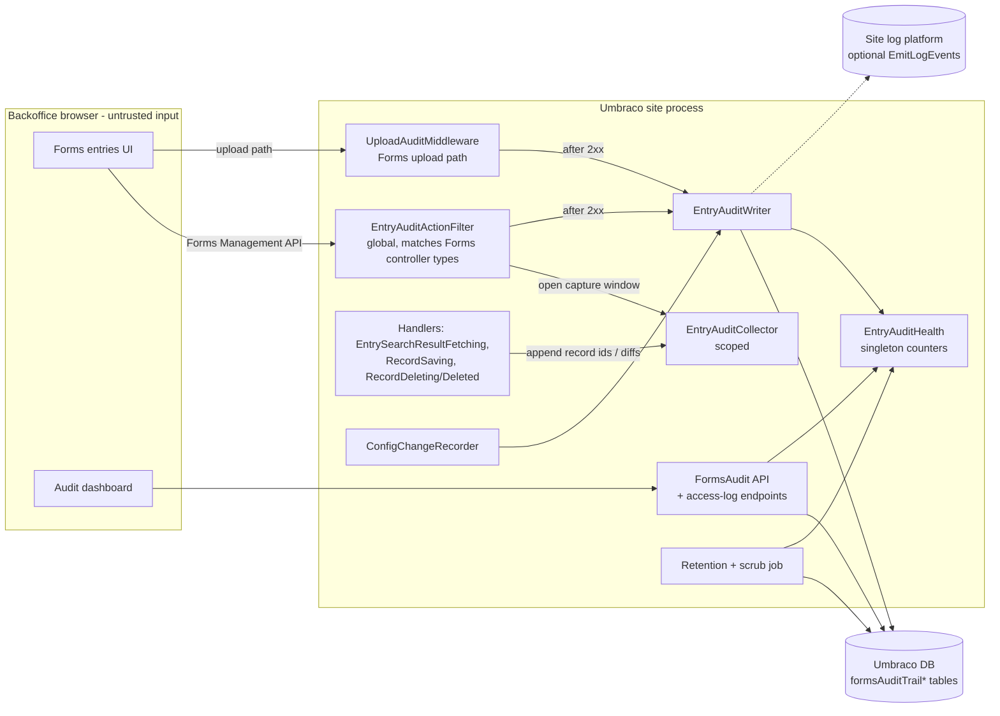

# 02 Forms compliance: design doc

| | |
|---|---|
| Package | `Umbraco.Community.FormsAuditTrail` (ID kept). MIT |
| Repo | https://github.com/PascalA94/Umbraco.Community.FormsAuditTrail (local: `~/Projects/Umbraco.Community.FormsAuditTrail`) |
| Current | 18.0.2 on `main`, 17.0.2 on `v17` |
| Target | **18.1.0** on `main`, then **17.1.0** on `v17` |
| Owner | Pascal Meyer |
| Status | Design, ready to plan. Security review applied 2026-10-30 (see "Security review changes"). Nothing built |
| Date | 2026-10-29, revised 2026-10-30 |
| Sources | `../02-forms-compliance/scope.md` (scope + Decisions), `../README.md` (portfolio rules), `security-review.md` (2026-10-30), the package source on `main` and `v17`, `~/.claude/references/umbraco-pitfalls.md` |

**How to read the tags**

- `[verified]` / `[unverified]`: carried over from the scoping doc. `[verified]` means it was seen in decompiled Forms 18.2.2 / 17.6.2 or the shipped Forms client source on 2026-10-29. No Forms code was run.
- `[HIGH - source code]`: read directly from this package's repo while writing this doc.
- `[HIGH - tool output]`: produced by a command run on 2026-10-30 (NuGet restore and `dotnet list package`, nuspec reads, Forms XML doc listings, GitHub advisory API). Scope is stated next to each one.
- `SEC-xx`: a finding in `security-review.md`. The section "Security review changes (2026-10-30)" maps each one to the change made here.
- `[DATED]`: Forms, CMS and Automate are moving fast. Every version fact here is as of 2026-10-29. Re-check before building.
- "(architect's call)": a choice made in this doc to unblock the plan. The builder may revisit it with a reason, but should not need to ask.

---

## 1. Intent and why

**One line:** *Forms Audit Trail: who touched your form data.*

**The repositioning story**

- Today the package audits **form definitions**: who changed a form's fields, pages and workflows, with field-level diffs, a cross-form dashboard and CSV export.
- In October 2026, Forms 17.6.0 / 18.2.0 shipped native form version history: a version on every save, rollback, compare and an Info-tab history `[verified, release notes]`.
  - So "who changed this form and can I restore it" is now native.
  - What is left unique on definitions: the cross-form view, field-level diffs, CSV export, and history that **survives a permanent form delete** (native delete wipes `UFFormVersions` `[verified]`).
- Nothing native, and no v17+ package, records **who looked at, exported or edited form entries** `[verified, NuGet + Marketplace sweep]`.
  - Native entry edits record who and when, with **no before and after values**.
  - Forms 18.2.2 / 17.6.2 added entry and export **permission checks** and per-user export folders. These are access controls, not logs.
- Entries are where the personal data is. A DPO answering a subject access request, or an agency investigating a compromised account, needs "who saw, exported or changed this person's data". That is the gap.

**So the package becomes:**

1. **Lead feature:** entry access audit. List views, entry opens, edits (with before and after), deletes, exports and downloads.
2. **Secondary feature:** the existing definition audit, unchanged.
3. **Later:** alerts and an Automate sub-package.

The NuGet ID, assembly, namespace, `App_Plugins/FormsAuditTrail` path and table prefix all stay. This is a change of scope, not of brand.

---

## 2. Goals, non-goals, anti-goals

**Goals**

- G1. Record every backoffice read, export, download, edit and delete of Forms entries, with the user and time.
- G2. Answer "who touched entry X" in one screen (entry history), including exports that contained it.
- G3. Show before and after values for backoffice entry edits, masking sensitive fields.
- G4. Treat the access log as personal data: minimised, retained for a limited time, scrubbed on erasure, readable only by named groups.
- G5. Upgrade in place from 18.0.x / 17.0.x with no manual steps and no data loss.
- G6. Fail loudly in CI, not silently in production, when Forms changes the hooks we rely on, or adds an entry endpoint we do not capture (SEC-01).
- G7. Make gaps visible. A write that fails, a config switch-off and a failed migration each leave a trace that a DPO sees in the dashboard, not only in a rotating application log (SEC-02, SEC-07, SEC-09).

G1 covers uploaded files served to the backoffice, workflow re-runs and backoffice-created entries, as well as the list, detail, edit, delete and export surfaces (SEC-01).

**Non-goals (MVP)**

- Edits made from code, workflows or the Delivery API.
- Front-end form submissions. These are not "access".
- Searching the log by a submitted value (for example an email).
- Datasource, prevalue source, folder and recycle-bin auditing.
- Tamper evidence (hash chain) and a retention report of what Forms deleted.
- Alerts and Automate triggers. Both are Later.
- Rollback or any write action on entries. The package stays view-only.

**Anti-goals: it fails even if it works**

- **It becomes a GDPR liability itself.** For example: it stores search terms with emails in them, keeps edit values after the entry was erased, or keeps the log forever.
- **It breaks or slows Forms.** An audit failure must never block or fail an entry save, delete, list or export. Adding a noticeable delay to the entries list (target: under 10 ms per request) also counts as failure.
- **It over-claims.** Calling itself "compliant", or letting a DPO believe the log is complete when direct SQL, code and the Delivery API are not captured.
- **It becomes a staff-surveillance tool** that any Forms editor can browse.
- **It weakens the existing security rules**: the per-form filter, 403 on an inaccessible form's list, 404 on an inaccessible entry.
- **It breaks existing installs**: lost definition history, a failed migration, or a forced config change on upgrade.
- **It silently stops recording** after a Forms minor renames a controller or notification.

---

## 3. Users and core use cases

| # | Who | Question | What they do |
|---|---|---|---|
| U1 | DPO, subject access request | "Jane asked who has seen her contact-form submission." | Entry history by record id. Sees views, edits, exports that contained it, downloads |
| U2 | DPO, after a leak | "Who exported the Enquiries form in March?" | Access log, Event = Exported, form, date range. Each row: user, filter, row count, downloaded or not |
| U3 | Agency, incident | "An account was compromised on Tuesday. What did it touch?" | Access log by user and date, all forms. CSV for the client's incident report |
| U4 | DPO, Art. 16 correction | "Who changed the email on entry 4812, and what was it?" | Entry history, edit row, field-by-field before and after (sensitive masked) |
| U5 | Site owner, governance | "Who removed the consent checkbox?" | Existing definition audit, still there after the form is permanently deleted |

- The record id (a GUID) is how a DPO finds an entry. They copy it from the Forms entries screen. Searching by email is Later.
- U1 is only fully answered for **list views** when `LogListRecordIds` is on, which it isn't by default (Decision 7). Detail opens, edits and exports are always answered by record id.

---

## 4. Constraints

**Versions** `[DATED]`

| Line | Branch | Package | CMS floor | Forms floor (new) | backoffice npm |
|---|---|---|---|---|---|
| v18 | `main` | 18.1.0 | **`[18.3.0, 19.0.0)`** (was 18.2.0; D9) | `[18.2.2, 19.0.0)` (was 18.1.3) | `^18.3.0` |
| v17 | `v17` | 17.1.0 | **`[17.8.0, 18.0.0)`** (was 17.7.0; D9) | `[17.6.2, 18.0.0)` (was 17.5.2) | `^17.8.0` |

- The CMS floors are Pascal's portfolio decision of 2026-10-30 (D9). They apply to all three CMS references (`Umbraco.Cms.Web.Common`, `Umbraco.Cms.Persistence.EFCore.Sqlite`, `Umbraco.Cms.Persistence.EFCore.SqlServer`).
- Raise both `Umbraco.Forms.Web` and `Umbraco.Forms.Core.Providers` floors. The Forms floors stay at 18.2.2 / 17.6.2: the security review did not show a reason to raise them, and they are the newest stable Forms releases on each line `[HIGH - tool output, nuget.org index 2026-10-30: Forms 18.2.2 and 17.6.2 latest stable; 18.3.0-rc and 17.7.0-rc only as previews]`.
- **CMS and Forms floors are compatible** `[HIGH - tool output, nuspec reads 2026-10-30]`:
  - Forms 18.2.2 (`Umbraco.Forms.Web`) depends on `Umbraco.Cms.Api.Management` and `Umbraco.Cms.Web.Website` `[18.2.0, 19.0.0)`; `Umbraco.Forms.Core` on `Umbraco.Cms.Web.Common` `[18.2.0, 19.0.0)`. CMS 18.3.0 is inside that range.
  - Forms 17.6.2 depends on the same CMS packages at `[17.6.0, 18.0.0)`. CMS 17.8.0 is inside that range.
  - Both pairs restore cleanly in scratch probe projects carrying the package's exact references. Scope: restore only. Runtime behaviour of Forms 17.6.2 on CMS 17.8.0, and of Forms 18.2.2 on CMS 18.3.0, is confirmed by the TestSite boot (plan Task 1) and the contract tests on the CI floor leg, not by this check.
- .NET 10 on both lines. Two release lines, not multi-targeting (portfolio rule allows this for 02; the Forms and backoffice npm majors differ).
- Repo rules from `CLAUDE.md` still apply `[HIGH - source code]`:
  - never merge `main` into `v17`; cherry-pick;
  - a version bump touches four files (csproj, `Client/package.json`, `package-lock.json`, `Client/public/umbraco-package.json`);
  - committed `wwwroot/`, checked by CI;
  - dual-provider EF migrations; `has-pending-model-changes` clean on both.
- The hooks were verified as identical on 17.6.2 and 18.2.2 `[verified]`, so 17.1.0 has the same scope as 18.1.0. If the 17.6.2 spike finds a gap, ship 17.1.0 without that one event and document it in the v17 README. Don't hold the release and don't split the design. (architect's call)
- The `v17` branch is not a copy of `main`. Its delete handlers differ (`FormsAuditDbContextExtensions.cs`, different `FormDeletedHandler` shape) `[HIGH - source code, git diff main..origin/v17]`. Expect manual cherry-pick work in the delete path.

**Dependency audit (SEC-05, D10)**

- The old floors (CMS 18.2.0 / 17.7.0) resolved `System.Security.Cryptography.Pkcs` 10.0.0 (High GHSA-846f-f764-76mx, Moderate GHSA-2fmv-rv2c-59x7) and `MessagePack` 3.1.8 (Moderate GHSA-qhrr-8q5h-9q3h) (security review, `[HIGH - tool output]`).
- First patched versions: Pkcs **10.0.13** for both Pkcs advisories; MessagePack **3.1.9** `[HIGH - tool output, GitHub advisory API 2026-10-30]`.
- At the new floors (CMS 18.3.0 + Forms 18.2.2, CMS 17.8.0 + Forms 17.6.2) NuGet resolves Pkcs 10.0.13 and MessagePack 3.1.11, and `dotnet list package --vulnerable --include-transitive` reports **no vulnerable packages** on either line `[HIGH - tool output, scratch probes 2026-10-30 00:59 UTC; the repo itself was not restored]`.
- The csproj still pins both packages directly, so the fix does not rest on Umbraco's transitive graph staying the same (Pascal, D10):
  - `<PackageReference Include="System.Security.Cryptography.Pkcs" Version="[10.0.13, 11.0.0)" />`
  - `<PackageReference Include="MessagePack" Version="[3.1.11, 4.0.0)" />`
  - The MessagePack pin is 3.1.11, not 3.1.9, because the CMS floor already requires 3.1.11 and a lower direct floor would raise NU1605 (package downgrade). Both pins restore cleanly with no NU1605 on either line `[HIGH - tool output, probes above]`.
  - The why-comment above them names the advisories and says when to remove a pin: once every supported CMS floor resolves the patched version on its own **and** CI's transitive audit is green without it. At today's floors that is already true, so the pins are a guard, not the fix. Removing them is a deliberate change with its own PR, never a tidy-up.
- `<NuGetAuditMode>all</NuGetAuditMode>` replaces `direct` (D10), with `<NuGetAuditLevel>low</NuGetAuditLevel>`. Restore then warns on transitive advisories locally too. The floor comment above it is rewritten to say why.
- CI fails on any High or Critical, transitive included, on **both** matrix legs (floor and latest) and on **both** branches:
  - restore with `-warnaserror:NU1903,NU1904` (High, Critical); and
  - `dotnet list ... package --vulnerable --include-transitive --format json`, parsed for `High` or `Critical`, because the command exits 0 even with findings (SEC-05, verified in the review).
  - A regression test for the parser feeds it a canned JSON report with one High and expects a non-zero exit.
- The already-released 18.0.x / 17.0.x packages are out of scope here (the lead session is checking them separately).

**GDPR: the access log is personal data**

- It holds staff identity (who did what) and record ids. Edit values can be the data subject's own data.
- Needs: minimisation, its own retention, erasure scrubbing, restricted access, and logging of access to the log itself (detail in 7.3 and 7.4).
- The Art. 17(3)(e) / Art. 5(2) reading that we may keep "who and when" after erasure is `[unverified legal reading]`. The README must tell site owners to confirm with their DPO and record the periods in their ROPA.
- On by default (D1) means the package starts **systematic monitoring of staff** on a minor upgrade (SEC-11). The README "GDPR" section must cover, at minimum:
  - **Lawful basis:** usually legitimate interests (Art. 6(1)(f)) with a documented legitimate-interests assessment, or the Art. 32 security obligation. The package cannot choose for the site owner.
  - **Transparency:** update the staff privacy notice (Art. 13). Staff can make a subject access request for their own activity in this log.
  - **DPIA:** screen for one. Employee monitoring often appears on supervisory authorities' "likely high risk" lists.
  - **ROPA:** record both retention periods and the reason for them.
  - **Backups:** scrubbing does not reach database backups.
  - **Scrub lag:** backoffice single and bulk deletes are scrubbed in the request. Up to 24 hours for form-level and scheduled deletes that publish no per-record event; if spike S5 finds no per-record delete event, up to 24 hours for **every delete made outside the backoffice** (Resolved by Pascal; plan review decision). The README states whichever applies.
  - **Erasure by clearing fields:** blanked values are not kept by default (E3, `KeepClearedValues`); erase by deleting the entry where possible.
  - **Disclosure to staff:** `StoreEditValues=All` shows sensitive values to access-log groups.
  - **Not tamper-evident:** the log lives in the site database and anyone with DB access can change it (SEC-08).
  - **Not complete:** the "What is not captured" list (SEC-01).
- **Release gate:** the README GDPR section and the upgrade notice are reviewed by a DPO or legal adviser before **18.1.0 stable** (the beta may ship without it). This is a release-checklist item (section 10), escalated by the security review, and is not something the package team can sign off.

**Security** (from `umbraco-pitfalls.md`, Critical and Security items)

- **S1:** every new endpoint must be authorised. The existing `FormsAuditApiController` is `ControllerBase` + `[Authorize(Policy = "SectionAccessForms")]` `[HIGH - source code]`. That is authorised, so S1 holds. New endpoints add a stricter group check on top.
- **P2:** never hold `IBackOfficeSecurityAccessor`, `HttpContext` or the current user in a static or singleton field. Resolve the user per request. The collector is **scoped**.
- **S3:** the dashboard renders user-controlled strings (form names, user names, field captions, edit values). Render as Lit text bindings only, never `unsafeHTML`.
- **CSV:** reuse `CsvFormatter.Escape` (formula-injection guard) for every cell in the new export. Harden it for a leading carriage return and for a trigger after leading whitespace (SEC-L1); this also hardens the existing definition CSV.
- Keep the existing anti-enumeration rules: 403 for an inaccessible form's list, 404 for an inaccessible single item.
- **Supply chain (SEC-13, SEC-I3, SEC-I4):** actions pinned to full commit SHAs; publish runs in a GitHub `environment: nuget` with a required reviewer and only for a tag whose commit is on `main` or `v17`; `v*` tags protected by a ruleset; GitHub secret scanning, push protection and Dependabot security updates on; CodeQL on PRs; `npm audit --audit-level=high` on both branches. The mf-harness `pr-checks.yml` ruleset does not reach this personal repo, so these stand in for it.
- `security-analyst` reviews the new endpoints, the access-log policy, the filter, the upload middleware and the writer before 18.1.0 stable.

**Keep existing installs working**

- Schema change is additive only. Existing tables and rows are untouched.
- Existing config keys (`RetentionDays`, `EnableCsvExport`) keep their meaning and defaults.
- Existing API routes and DTOs keep their shape. New fields are additive.
- Migrations still run through `RunAuditMigration` at `RuntimeLevel.Run`.

---

## 5. Decisions already made (Pascal, 2026-10-29)

All eight recommended defaults were accepted.

| # | Decision |
|---|---|
| D1 | Entry audit is **on by default**. Edits, exports, downloads, list views and detail views are all logged. List views do **not** record entry ids. README tells site owners to update their ROPA |
| D2 | The access log is readable by a **config list of user groups**, default `admin` |
| D3 | Raise the floor to **Forms 18.2.2 / 17.6.2** in the **18.1.0 / 17.1.0** minors |
| D4 | **Keep the NuGet ID** `Umbraco.Community.FormsAuditTrail`. Retitle the package and its Marketplace listing |
| D5 | Edit values use **`MaskSensitive`** and are **nulled after 90 days**. The who and when stay |
| D6 | Automate ships as a **`.Automate` sub-package**, after the MVP |
| D7 | **`LogListRecordIds` is off.** Revisit with beta volume data |
| D8 | The access log uses the **package's own tables**, not `umbracoAudit` |

Added by Pascal on 2026-10-30 (final):

| # | Decision |
|---|---|
| D9 | Portfolio CMS floors: **`[18.3.0, 19.0.0)`** on `main`, **`[17.8.0, 18.0.0)`** on `v17`. Forms floors unchanged |
| D10 | `NuGetAuditMode=all`, and pin the vulnerable transitive packages (SEC-05) |

Earlier scope choices that these rest on, not re-opened:

- Feature release is a **minor** (additive schema), not a major.
- Hooks: an **MVC action filter** marks the request kind; **notifications** supply record ids; **one writer** flushes after the action succeeds.
- Access tables live in the **same `DbContext`** as the existing tables (one migration history).

---

## 6. Functional spec

### 6.1 Keep (no behaviour change)

- Form create, save and delete audit, with field-level diffs and workflow and page changes.
- Cross-form dashboard, filters, raw JSON viewer, CSV export with formula-injection guard.
- Per-form security filtering and the 403/404 rules.
- `RetentionDays` for definition entries (default 0 = forever).
- History kept after a permanent form delete.
- Known limits stay documented: workflow property edits show on next save; rollbacks show as Saved; copies as Created; Deploy as System; recycle bin not recorded.

**Regression AC**

- Given an 18.0.2 site with definition audit rows, when it upgrades to 18.1.0, then every existing row is still shown, unchanged, in the "Form changes" sub-tab.
- Given a user with Forms access but no access-log group, when they open the Audit dashboard, then they see "Form changes" exactly as before.

### 6.2 New MVP: entry access audit

Backoffice activity only.

**E1. Entry list viewed**
- Given entry audit is on, when a user opens a form's Entries list, changes page or changes filter, then one `ListViewed` row is written with user, form, filter summary, page and row count.
- Given `LogListRecordIds` is false (default), then no record ids are stored for list views.
- Given `LogListRecordIds` is true, then the record ids on that page are stored as child rows, up to 500 per row; beyond that the row sets `Detail.recordIdsCaptured = false` (SEC-10).
- Given the same user loads the same form, filter and page within `DeduplicateSeconds` (default 60), then no new row is written.
- Given `LogListViews` is false, then no `ListViewed` rows are written.

**E2. Entry opened**
- Given a user opens an entry in the details modal, when the modal calls `GET .../record/{id}/audit-trail`, then one `DetailViewed` row is written with that record id.
- Given the same user reopens the same entry within `DeduplicateSeconds`, then no new row is written.

**E3. Entry edited**
- Given a user saves changes to an entry in the backoffice, when the save returns 2xx, then one `Edited` row is written with a before and after value per **changed** field.
- Given a changed field is marked sensitive and `StoreEditValues` = `MaskSensitive`, then its before and after are stored as `[masked]` and `Masked` = true.
- Given `StoreEditValues` = `None`, then the changed field ids and captions are stored, and both values are null.
- Given a changed field's new value is empty or whitespace and `KeepClearedValues` is false (default), then `OldValue` and `NewValue` are null and `Cleared` = true. The UI shows "Value cleared". Who, when and which field remain (SEC-03).
- Given `KeepClearedValues` is true, then the old value is stored under the normal `StoreEditValues` and masking rules, and `Cleared` is still true.
- Given the before values are read, then they come through Forms' own read path, so any decrypting hook a site has registered runs first (SEC-04, 7.3).
- Given the save fails (4xx/5xx or an exception), then nothing is written.
- Given an update changes no field values (approve, reject, state change), then no `Edited` row is written.
- Given a front-end submission (insert), then nothing is written.

**E4. Entry deleted**
- Given entries are deleted in the backoffice, then a `Deleted` row is written with the user: one per single delete, one per bulk delete with the record ids as child rows (plan review P8), and one per form delete. Entry history finds a bulk delete through its child row.
- Given that, the stored edit values for those records are scrubbed (see 7.3).

**E5. Export generated**
- Given a user generates an export, when it returns 2xx, then one `Exported` row is written with user, form, export type, filter summary, file name and row count, plus a child row per exported record id.
- Given the child rows cannot be written (timeout, size), then the `Exported` row still exists, with `Detail.recordIdsCaptured = false` (SEC-02). The parent row is written first, in its own save.
- Given `FailClosedOnExport` is true and the `Exported` or `ExportDownloaded` row cannot be written, then Forms' response is replaced by 503 and no file name or file is returned. Default false (SEC-02).
- Given `FailClosedOnExport` is true and the `AuditExported` row of an access-log CSV export cannot be written, then the export returns 503 before any byte is sent. The option covers the access-log CSV as well as Forms' exports and downloads. Default false (SEC-02).
- Given an exporter that does not read through `IFormRecordSearcher` (for example the "uploaded files" exporter), then the `Exported` row is still written, with record ids missing and `Detail.recordIdsCaptured = false`. (architect's call)
  - This gap is accepted. The scope rejected wrapping each exporter because it is invasive and would still miss third-party exporters. No second capture path in MVP.
  - The UI says so. On that row, the Entry column shows "N entries (ids not captured)". Entry history adds a note: "Exports from some exporters don't record which entries they contained. See the Entry access log for all exports of this form."

**E6. Export downloaded**
- Given a user downloads a generated export, when the file is served (2xx), then an `ExportDownloaded` row is written and linked to its `Exported` row by `CorrelationId`.
- Given no matching `Exported` row exists (for example an export generated before upgrade), then the row is written with a null `CorrelationId`.

**E7. Access log screen**
- Given a user in an access-log group, when they open Audit > Entry access, then they can filter by form, user, event, date range and record id, page through results and export CSV.
- Given a user not in an access-log group, then the Entry access and Entry history sub-tabs are hidden and the access-log API returns 403.
- Given a row for a form the user cannot access, then it is never returned.
- Given a row with `FormId = Guid.Empty` (unresolved form, unfiltered `AuditExported`, member lookups, config changes, audit gaps), then it is returned only to a user who can access every form (SEC-L3).
- Given the search uses a `userKey` or `recordId` filter, then an `AuditSearched` row is written (deduplicated). Other filter use is not logged (SEC-06).

**E8. Entry history**
- Given an access-log user enters a record id (or follows a deep link), then they see that entry's full timeline: list views (if ids were captured), opens, edits, deletes, exports that contained it, and downloads of those exports.
- Given the record belongs to a form they cannot access, then the API returns 404.

**E9. Retention**
- Given `EntryAudit:RetentionDays` = N (default 365), then access rows older than N days, and their child rows, are deleted daily.
- Given `EntryAudit:EditValueRetentionDays` = M (default 90), then `OldValue` and `NewValue` older than M days are nulled daily, `ValuesScrubbedAt` is set, and the row is kept.
- Given `EntryAudit:RetentionDays` = 0, then access rows are kept forever, and the dashboard banner says so. (architect's call: same meaning as the existing `RetentionDays`)

**E10. Turning it off**
- Given `EntryAudit:Enabled` = false, then no hook writes anything, the filter does no work, and the Entry access tab shows the "switched off" empty state.
- Given it is turned off, then existing access rows remain readable and retention still runs. (architect's call)
- Given it is turned off and later on again, then a `ConfigChanged` row records each change and the dashboard says "Entry auditing was off from X to Y" (E17).

**E11. The log is logged**
- Given an access-log user exports the access log as CSV, then an `AuditExported` row is written.
- Given an access-log user opens an entry history, then an `AuditViewed` row is written with that record id (deduplicated like E2). (architect's call: the scope says reading the log is itself logged; this is the minimum that is useful without logging every filter click)
- Given an access-log user opens `access/{id}` on an `Edited` row whose values are not yet scrubbed, then an `AuditViewed` row is written with that row's form and record id (deduplicated) (SEC-06).
- Given an access-log user lists `access` with a `userKey` or `recordId` filter, then an `AuditSearched` row is written with the shaped filter in `Detail` (deduplicated) (SEC-06). This is the "what did this colleague do" query.

**E12. Failure never blocks Forms, and never hides itself**
- Given the audit write throws (database down, lock, bug), when a Forms action runs, then the Forms action succeeds unchanged and the error is logged at Error level with `userKey`, event type, form id and record count. (architect's call: fail-open, matching the existing handlers' "never block a save" rule; default unchanged by the security review)
- Given that, then the health signal records the failure (E18), and the next successful write adds an `AuditGap` row with the count, the first and last failure times and the event types missed (SEC-02).
- Given a client aborts the request, then the write still runs: the writer never takes `HttpContext.RequestAborted` (SEC-02).
- Given a form name, user name or field caption longer than its column, then the value is truncated to fit and the row is written. `Detail` is capped at 8 KB with `truncated: true` (SEC-02).
- Given the form id cannot be resolved, then the row is still written, with `FormId = Guid.Empty` and `Detail.formUnresolved = true`, visible only to users who can access every form (SEC-02, SEC-L3).
- The only exception is the opt-in `FailClosedOnExport` (E5), which returns 503 for a Forms export or download, and for an access-log CSV export, whose row cannot be written.

**E13. Uploaded file opened** (SEC-01)
- Given a backoffice user opens a file uploaded with an entry, when Forms' upload middleware serves it with 2xx, then one `FileViewed` row is written with user, form and a hash of the file path (deduplicated).
- Given Forms' middleware refuses the request (401, 403, 404), then nothing is written.
- Given entry history for a record that still exists, then `FileViewed` rows whose path hash matches one of the record's upload values appear in its timeline.

**E14. Workflow re-run** (SEC-01)
- Given a user re-runs a record's workflow, when it returns 2xx, then one `WorkflowRetried` row is written with the record id and workflow id. No field values. It is a data egress (email, webhook, CRM), so it is never deduplicated.

**E15. Entry created in the backoffice** (SEC-01)
- Given a user creates an entry through the backoffice, when it returns 2xx, then one `Created` row is written with the record id and the captions of the fields set. No values. Front-end submissions are still not recorded (non-goal).

**E16. Member lookup** (SEC-01)
- Given a user asks which forms a member has submitted to, when it returns 2xx, then one `MemberSummaryViewed` row is written with `FormId = Guid.Empty`. The member identifier is stored only when it is a key (GUID or integer id); an email or other free text is dropped and `memberIdentifierUsed: true` is stored instead, the same rule as search terms. (architect's call)

**E17. Config changes are recorded** (SEC-07)
- Given any `EntryAudit` key changes at runtime (through `IOptionsMonitor`) or between restarts, then one `ConfigChanged` row is written by the system user with the old and new values of the changed keys. Secrets are never included (the section holds none today; the writer uses an allow-list of key names).
- Given `EntryAudit:Enabled` is false, then `ConfigChanged` rows are still written. They are the one write the master switch does not stop.
- Given the daily job deletes more than 1,000 access rows in one run, then it logs at Warning.

**E18. Health is visible** (SEC-02, SEC-09, SEC-I1)
- Given the last write failed, migrations are pending, or the daily job has not completed successfully in 48 hours, then `config` returns `entryAuditHealthy = false` with the reasons, and the dashboard shows a red banner to access-log users.
- Given a migration fails at startup, then the app keeps running (as today) and the health signal says why.

### 6.3 Later

| Item | Depends on |
|---|---|
| Package notifications `FormsAuditRecordedNotification`, `FormEntriesExportedNotification` | MVP writer |
| Email and webhook alerts (form/workflow change, large export) | Package notifications |
| `.Automate` sub-package (D6) | Package notifications, Automate spike (7.8) |
| Recycle-bin audit for forms and folders | Forms 18.3 GA (`FormMovedToRecycleBinNotification` is in 18.3.0-rc only `[verified]`); check 17.x gets them |
| Datasource, prevalue source, folder audit | Notifications exist `[verified]`; low demand |
| Edits from code, workflows, Delivery API | A non-HTTP flush path |
| Search the log by submitted value | Lookup against live entries; never store the value |
| Hash chain; retention report | Demand evidence. `EmitLogEvents` (7.7) is the MVP's independent copy (SEC-08) |
| "Scrub stored values for this entry" backoffice action (access-log groups only, itself logged) for erasures done by partial overwrite | SEC-03 item 2 |
| `NotAudited` surfaces that S11 shows return entry values | S11 result |
| Per-form "Audit" workspace view | `workspaceView` + `Umb.Condition.WorkspaceAlias` |
| Staff erasure ("Deleted user" after retention) | |
| Turn on `LogListRecordIds` by default | Beta volume data (D7) |

---

## 7. Technical design

### 7.0 What exists today `[HIGH - source code, main @ 96cbca8]`

- **Persistence:** EF Core, its own connection (not Umbraco's NPoco scope). Abstract `FormsAuditDbContext` with `SqliteFormsAuditDbContext` / `SqlServerFormsAuditDbContext`, picked per request by `UmbracoDatabaseProviderDetector`. Migrations in `Migrations/Sqlite` and `Migrations/SqlServer`, history in `formsAuditTrailMigrationsHistory`.
- **Tables:**
  - `formsAuditTrailEntries`: `Id int`, `FormId`, `FormName(500)`, `UserKey`, `UserName(500)`, `Timestamp` (UTC converter), `EventType int` (0 Created, 1 Saved, 2 Deleted), `BeforeSnapshot`, `AfterSnapshot`, `ChangeSummaryJson`. Indexes: Timestamp, FormId, UserKey.
  - `formsAuditTrailChanges`: `Id`, `AuditEntryId` (FK, cascade), `ChangeType`, `PropertyPath(1000)`, `FriendlyDescription(2000)`, `OldValue`, `NewValue`, `Category`.
- **Handlers:** `FormSavingHandler` (captures before into `notification.State`), `FormSavedHandler` (diffs against last `AfterSnapshot`, writes in a fresh scope), `FormDeletingHandler` (captures only, never writes: SQLite "table is locked"), `FormDeletedHandler` (writes), `RunAuditMigration` (on `UmbracoApplicationStartedNotification`).
- **User:** `AuditHandlerHelpers.GetCurrentUser(IBackOfficeSecurityAccessor)`; empty key + "System" when no user.
- **API:** `FormsAuditApiController`, route `umbraco/formsaudit/api/v1`, policy `SectionAccessForms`. Endpoints: `config`, `entries`, `entries/{id}`, `forms`, `users`, `entries/export`.
- **Retention:** `AuditRetentionJob`, `IRecurringBackgroundJob`, every 24h, 5 min delay, `ServerRole.Single`/`SchedulingPublisher`, `ExecuteDeleteAsync`.
- **Options:** `FormsAuditTrailOptions` bound from `FormsAuditTrail`, `IOptionsMonitor`.
- **Client:** Lit + Vite. One dashboard `UmbracoCommunity.FormsAuditTrail.Dashboard` in `Umb.Section.Forms`, label "Forms Audit Trail", pathname `forms-audit-trail`. Calls the API with `fetch` and a bearer token from `UMB_AUTH_CONTEXT`. `audit-diff-viewer` element.
- **Tests:** xUnit v2 + NSubstitute, in-memory SQLite `TestDatabase` (uses `EnsureCreated`, not migrations).

### 7.1 Components and trust boundary

- **Trust boundaries** for `security-analyst`:
  - Browser → Forms Management API: request parameters (filters, search terms, file names) are untrusted. Store them only after shaping (7.2 `Detail` rules).
  - Browser → our API: every parameter is untrusted. Policy + group check + per-row form check.
  - Our DB rows contain user-supplied text (form names, captions, values). Treat as untrusted on render (S3) and in CSV (formula guard).
  - Browser → Forms upload path: served by Forms' `ProtectFormUploadRequestsMiddleware`, outside MVC, so the action filter never sees it. Our `UploadAuditMiddleware` observes the final status only; it never authorises, serves or changes the response (SEC-01).
  - Config and hosting → our options: `EntryAudit` keys change live and are themselves recorded (E17). The DB principal needs DDL rights at first start (SEC-09).
  - Site DB: rows are writable by anyone holding the connection string. The log is not tamper-evident (SEC-08); `EmitLogEvents` lets a site ship an independent copy.

**Request flow**

1. `EntryAuditActionFilter.OnActionExecutionAsync` checks `ControllerActionDescriptor.ControllerTypeInfo` against a fixed set of Forms controller types. No match → `await next()` and return. Cost: one type comparison.
2. On a match, and with `EntryAudit:Enabled`, it opens a capture window on the scoped `EntryAuditCollector` with the event kind and form id (from route/query).
3. Forms runs. Our notification handlers append to the collector **only if** a window is open. Front-end submissions and workflows never open one, so they cost nothing.
4. After `await next()`, the filter checks the result. Success = no exception and (`ObjectResult`/`StatusCodeResult` with status null or 2xx, or any `FileResult`). (architect's call)
5. On success, `EntryAuditWriter` writes one access row plus child rows, in a **fresh DI scope** with its own `FormsAuditDbContext` (same pattern as `FormSavedHandler`). On failure, discard.
   - **Lifetimes (plan review P2):** the writer is a singleton that opens a scope per write, because the singleton `ConfigChangeRecorder` consumes it. No singleton takes a scoped dependency; a composition test validates scopes on build.
   - **Synchronous, no queue in MVP** (architect's call). By the time `next()` returns, Forms' scope has completed, which is the same timing `FormSavedHandler` already uses safely on SQLite. A lost row is worse than a few milliseconds. Only if S3 shows a lock, fall back to an `IAsyncResultFilter` write (still synchronous). A background queue is out of scope for MVP.
   - **Write shape (SEC-02, SEC-10):**
     - Truncate every bounded string to its column length (`FormName`, `UserName`, `FieldCaption`: 500) before writing. Put the original length in `Detail.originalLengths` when truncated. Cap `Detail` at 8 KB and set `truncated: true`.
     - Save the **parent** access row on its own first (`SaveChangesAsync`). Then insert child record ids in batches of 1,000 with change tracking off (`ChangeTracker.AutoDetectChangesEnabled = false`, `ChangeTracker.Clear()` after each batch). Edit changes are few and go with the parent.
     - If a child batch fails, update the parent's `Detail.recordIdsCaptured = false` and record the failure in health. The parent is never lost because its children failed.
     - Always `CancellationToken.None`. Never `HttpContext.RequestAborted`: a client that aborts must not cancel the evidence.
     - The writer catches its own exceptions and returns a result (`Written`, `Deduplicated`, `Failed`). The filter decides what a failure means: log and carry on (E12), or 503 under `FailClosedOnExport` for `Exported` and `ExportDownloaded` (E5). The access-log CSV export applies the same option to its own `AuditExported` row, before any byte is sent (R56).
     - On `Failed`, record it in `EntryAuditHealth` and log at Error with `userKey`, event type, form id and record count. On the next `Written`, if failures happened since the last success, add one `AuditGap` row (E12).
     - When `EmitLogEvents` is true, after each `Written`, emit one structured log event (`FormsAuditTrail.Access`) with the row's id, time, event, form id, user key and record count. No values, no `Detail`; record ids only when `EmitLogEventRecordIds` is true (SEC-08).
   - **Fail-closed hook:** an action filter can still replace `ActionExecutedContext.Result` after `next()`, so the 503 needs no second filter. If S3 moves the write to `IAsyncResultFilter`, fail-closed moves with it and runs before the result executes.

**Where the form id and record id come from** (architect's call)

- Take them from route values and query string where the controller has them (`formId`, `id`).
- If a controller only has a record id (for example `GetAuditTrailController`), resolve the form id from the record. The record is in the `RecordFetchingNotification` that Forms publishes in the same request `[verified]`, or call `IRecordStorage` once if needed.
- `ExportController` has `formId` and `fileName` in the query `[verified]`.
- S1 records the exact parameter source per controller.
- If the form id can't be resolved, **still write the row**, with `FormId = Guid.Empty`, `FormName = "(unresolved form)"` and `Detail.formUnresolved = true`, and log a Warning. The per-form rules stay intact because `Guid.Empty` rows are shown only to users who can access every form (7.5 step 4). Skipping the row would let any request that defeats resolution leave no trace (SEC-02, SEC-L3).
6. Any exception in steps 2 to 5 is caught and logged. Forms' response is never changed (E12), except under the opt-in `FailClosedOnExport` (E5).

### 7.2 Schema changes and migration

**Existing tables:** no change in MVP.

**New table `formsAuditTrailAccess`**

| Column | Type | Null | Notes |
|---|---|---|---|
| Id | bigint identity | no | PK |
| Timestamp | datetime (UTC) | no | Indexed. Reuse the UTC value converter |
| EventType | int | no | See enum below |
| FormId | uniqueidentifier | no | Indexed |
| FormName | nvarchar(500) | no | Copied at write time; survives form delete |
| RecordId | uniqueidentifier | yes | Single-record events only. Indexed |
| RecordCount | int | no | Rows on the page / in the export; 1 for single-record events |
| UserKey | uniqueidentifier | no | Indexed. `Guid.Empty` = System (jobs, config changes) or Unknown (a backoffice request with no resolvable user; `Detail.userUnresolved = true`, never shown as "System") (SEC-L5) |
| UserName | nvarchar(500) | no | Copied at write time, truncated to fit (SEC-02) |
| Detail | nvarchar(max) | yes | JSON, see below |
| CorrelationId | uniqueidentifier | yes | Links Exported ↔ ExportDownloaded. Indexed (architect's call) |

Add a composite index on `(FormId, Timestamp)` for the common filter. (architect's call)

**New enum `AccessEventType`** (separate from the existing `AuditEventType`, so the definition audit's 0 to 2 are untouched):

| Value | Name |
|---|---|
| 10 | ListViewed |
| 11 | DetailViewed |
| 12 | Edited |
| 13 | Deleted |
| 14 | Exported |
| 15 | ExportDownloaded |
| 16 | AuditExported |
| 17 | AuditViewed (architect's call, see E11) |
| 18 | FileViewed (E13, SEC-01) |
| 19 | AuditSearched (E11, SEC-06) |
| 20 | WorkflowRetried (E14, SEC-01) |
| 21 | Created (E15, SEC-01) |
| 22 | MemberSummaryViewed (E16, SEC-01) |
| 23 | ConfigChanged (E17, SEC-07) |
| 24 | AuditGap (E12, SEC-02) |

Values 18 and 19 are the ones the security review proposed. 20 to 24 are the architect's numbering. Values are never reused or renumbered once shipped.

**New table `formsAuditTrailAccessRecords`** (answers "which exports contained Jane's entry")

- `AccessId` bigint, FK to `formsAuditTrailAccess.Id`, cascade delete.
- `RecordId` uniqueidentifier, indexed.
- PK (`AccessId`, `RecordId`).
- Written for: Exported (always, when captured), ListViewed (only when `LogListRecordIds`), bulk Deleted if the builder chooses one row per bulk action (see 7.3).

**New table `formsAuditTrailEntryChanges`** (edit diffs)

| Column | Type | Null | Notes |
|---|---|---|---|
| Id | bigint identity | no | PK |
| AccessId | bigint | no | FK, cascade |
| FieldId | uniqueidentifier | no | |
| FieldCaption | nvarchar(500) | no | Copied at write time, truncated to fit (SEC-02) |
| OldValue | nvarchar(max) | yes | Nulled by scrub or retention; null when `Cleared` and `KeepClearedValues` is false |
| NewValue | nvarchar(max) | yes | Nulled by scrub or retention |
| Masked | bit | no | True when the field was sensitive and masked |
| Cleared | bit | no | True when the new value is empty or whitespace (SEC-03) |
| ValuesScrubbedAt | datetime (UTC) | yes | Set when values are nulled |

**New table `formsAuditTrailState`** (architect's call; small key-value store that survives restarts and is shared across load-balanced servers)

| Column | Type | Null | Notes |
|---|---|---|---|
| Key | nvarchar(100) | no | PK |
| Value | nvarchar(4000) | yes | JSON |
| UpdatedUtc | datetime (UTC) | no | |

Keys written in MVP:

- `config.entryAudit`: the last recorded `EntryAudit` values (allow-listed keys only), so a restart with changed appsettings writes `ConfigChanged` (E17).
- `job.lastRun`: start, end, and per-step outcome of the daily job, so every server's health signal knows when the scheduling publisher last scrubbed (SEC-I1).

Per-request write failures stay in memory (`EntryAuditHealth`), because a failing database cannot record its own failure. They become persistent through the `AuditGap` row once writes succeed again (E12).

**`Detail` JSON rules**

- Allowed keys: `filter` (shaped, see below), `page`, `pageSize`, `exportType`, `fileName`, `recordIdsCaptured`, `bulk`, `deleteKind` (`single` | `bulk` | `form`), and from the security review: `formUnresolved`, `userUnresolved`, `truncated`, `originalLengths`, `workflowId`, `fieldCaptions` (for `Created`), `filePathHash`, `memberKey`, `memberIdentifierUsed`, `config` (for `ConfigChanged`: `{key: {old, new}}`), `gap` (for `AuditGap`: `{count, firstUtc, lastUtc, eventTypes}`), `beforeUnavailable` (the before read failed; the edit is still recorded, without a diff).
- `filter`: date range, state filter, sort. The free-text **search term is dropped** unless `CaptureSearchTerms` is true. Store `"searchTermUsed": true` instead so the DPO knows a search was run. (architect's call)
- `fileName` (from the request) is capped at 260 characters. Every request-supplied string in `Detail` passes through the CSV formula guard on export (SEC-L1).
- Whole `Detail` capped at 8 KB (E12).
- Version the JSON with `"v": 1`. (architect's call)

**Multi-value and file-upload fields** (architect's call)

- Store a field's values as a JSON array string when it has more than one value; a plain string otherwise.
- File-upload values are file paths. Store them like any other value (masked if sensitive).

**Migration plan**

- One EF migration per provider, named `AddEntryAccessAudit`, in `Migrations/Sqlite` and `Migrations/SqlServer`.
- Same `DbContext`, new `DbSet`s: `AccessEntries`, `AccessRecords`, `EntryChanges`, `State`. Add table-name constants beside the existing ones.
- Run `has-pending-model-changes` for both contexts.
- Applied by the existing `RunAuditMigration`. It still catches and logs, so a failed migration never stops the site, but it now also sets `EntryAuditHealth.MigrationsPending` from `GetPendingMigrationsAsync()` after it runs (SEC-09). The README states that the DB principal needs DDL rights at first start.
- Concurrent first start on load-balanced servers: EF Core 9+ takes a migration lock on SQL Server and SQLite `[DATED]`. Spike S12 re-checks this on the EF 10 version actually resolved (SEC-I5); if two instances race, the health signal shows it.
- Purely additive. No backfill (there was no access data before). Pitfalls D1 to D4 do not apply.
- **Downgrade:** the new tables are ignored by 18.0.x. Ship a `DROP` script in the README (drop the two child tables first, then `formsAuditTrailAccess` and `formsAuditTrailState`, then delete the `AddEntryAccessAudit` row from `formsAuditTrailMigrationsHistory`). Above the script, the README says: "Export the access log first. Dropping these tables deletes a record your ROPA may rely on." The script stays manual, never automatic (SEC-L7).
- **Later:** `EntityType int not null default 0` on `formsAuditTrailEntries` for recycle-bin and other entities.
- Note: `TestDatabase` uses `EnsureCreated`. The upgrade test (section 9) must apply real migrations on top of an 18.0.2-shaped database instead.

### 7.3 Hooks per event

All Forms types below are `[verified]` on 18.2.2 and 17.6.2 unless tagged.

**Forms entry surface inventory** `[HIGH - tool output, Umbraco.Forms.Web.xml for 17.6.2 and 18.2.2 from the local NuGet cache, 2026-10-30]`: the public types in `Umbraco.Forms.Web.Api.ManagementApi.{Record,Export,Member,Media}` are the same 23 on both versions. **Scope:** type names and XML doc summaries only. What each endpoint returns and how the upload middleware behaves were run in S11 on both versions (S11, docs/spikes.md): the same on both, and the audited set below is unchanged.

**Controller types the filter matches** (all public, derive from `FormsManagementApiControllerBase`):

| Controller | Event |
|---|---|
| `GetCollectionController` | ListViewed |
| `GetAuditTrailController` | DetailViewed |
| `UpdateRecordController` | Edited (confirm) |
| `DeleteRecordController` | Deleted (single) |
| `ExecuteActionController` | Deleted (bulk) / other bulk actions `[unverified bulk path]` |
| `PostGenerateExportController` | Exported |
| `ExportController` (`GetExport`) | ExportDownloaded |
| `RetryWorkflowController` (`Retry(formId, recordId, workflowId)`) | WorkflowRetried (SEC-01) |
| `CreateRecordController` (`Create(formId, fields)`) | Created (SEC-01) |
| `GetMemberFormSummariesController` (`GetFormSummaries(string)`) | MemberSummaryViewed (SEC-01; a direct data-subject lookup) |

**`NotAudited` allow-list** (architect's call, from the XML summaries; each carries this reason in code and is named in the README and dashboard "not captured" list):

| Type | Reason |
|---|---|
| `GetMetadataController` | Collection metadata for a filter (`{count, lastSubmittedDate}`), not entry values (S11, docs/spikes.md) |
| `GetWorkflowAuditTrailController` | Workflow run status for a record, not field values (S11, docs/spikes.md) |
| `GetPageNumberController` | Returns a page number for a record id, no values |
| `GetRecordSetActionCollectionController` | Lists available bulk actions, no entry data |
| `GetRecordsControllerBase`, `RecordControllerBase`, `MediaControllerBase` | Abstract bases, no endpoints of their own |
| `GetByPathMediarController` | CMS media by path (the Forms type name has this spelling), not Forms uploads |
| `Member.GetLinkableMemberPropertiesController` | Member type properties, no entry data |
| `Export.GetExportTypesController` | List of exporters |
| `GenerateExportResponseModel`, `LinkableMemberProperty`, `MemberFormSummary` | Models, not controllers |

The rule for any type S11 or a later Forms version adds: an endpoint that returns entry field values, uploaded files or the record ids of a data subject is audited. Anything else may go on the allow-list with a one-line reason.

- Reference these by `typeof(...)` in a single static set. A Forms rename then breaks **our build**, not production.
- **Completeness contract test (SEC-01, extends G6):** by reflection, enumerate every public type in `Umbraco.Forms.Web.Api.ManagementApi.{Record,Export,Member,Media}` and fail unless each one is in the audited set or in `NotAudited`. It runs on both CI matrix legs on both branches, so a new Forms entry endpoint breaks CI instead of quietly widening the gap.
- Register globally: `services.Configure<MvcOptions>(o => o.Filters.Add<EntryAuditActionFilter>())`.
- **Fallback** if M0 shows the filter cannot see these controllers: ASP.NET Core middleware matching the route `umbraco/forms/management/api/v1/...` plus endpoint metadata. The capture logic lives in one `EntryAuditCapture` class, so the fallback swaps only a thin adapter (plan review P13a):
  - Registered at the post-routing stage, so the endpoint and its `ControllerActionDescriptor` are known; same `typeof` map.
  - No `ActionArguments`: route and query from the request; for controllers whose ids are only in the body (bulk delete, create), buffer and read the JSON body up to 1 MB, then rewind. Larger or unreadable bodies give `formUnresolved` or `recordIdsCaptured: false`.
  - Success is the final status 200 to 299.
  - User from `HttpContext.User` after `next()`, by the user-key claim S1 records; none gives "Unknown".
  - Before snapshot unchanged (record id from the route, before `next()`).
  - `FailClosedOnExport`: only when on, export and download responses are buffered (`FileBufferingWriteStream`) so a failed write can still become a 503; with it off nothing is buffered.

**Uploaded files: `UploadAuditMiddleware` (E13, SEC-01)**

- Forms serves uploads from `/media/forms/upload/` and authorises them in `Umbraco.Forms.Web.HttpModules.ProtectFormUploadRequestsMiddleware` `[HIGH - tool output: type and summary present in 17.6.2 and 18.2.2]`. That is middleware, so no MVC filter runs and the route fallback above does not cover it.
- Our middleware matches the same upload path, calls `next()`, and after it returns writes `FileViewed` only when the final status is 2xx. It never changes the response, and it fails open like the filter. The upload root is the literal `/media/forms/upload/`: Forms has no option for it and hard-codes it, so we hold the same constant and a contract test pins it. Forms matches segment by segment (empty segments dropped, case-insensitive), so we match the same way; a plain prefix test misses `//media/forms/upload/...`, which Forms serves (S11, docs/spikes.md).
- Registration through an `UmbracoPipelineFilter` at `PrePipeline`, inserted immediately before Forms' filter named `ProtectFormUploadRequestsMiddleware` (S11, docs/spikes.md). Later stages never run for a served upload, because the media file provider short-circuits first. The user comes from the backoffice cookie read the way Forms reads it, because `HttpContext.User` is not authenticated at `PrePipeline`. The requirement is that it sees the **final** status of every upload-path request; running outside Forms' middleware (so a 403 from Forms is observed and skipped) meets it.
- Form id: resolved the way Forms does ("the form the requested file was uploaded to"). Forms takes the first path segment starting with lower-case `form_` and parses the rest as a Guid; we do the same (S11, docs/spikes.md). Unresolved: `Guid.Empty` + `formUnresolved` (E12).
- The file path is **not** stored, because upload file names often contain the data subject's name (a CV). Store `filePathHash` = SHA-256 of the normalised path relative to the upload root. Entry history matches `FileViewed` rows by hashing the record's own upload values at read time, which works while the record exists and stops working after erasure, as it should. (architect's call)
- Dedupe: yes, like DetailViewed (browsers issue range and preview requests for one open).
- Statuses (plan review P9, architect's call): 200 and 206 write `FileViewed` (range requests of one open dedupe to one row); 304 also writes, because the user opened the file again and a rare duplicate is acceptable where a missing row is not; 401, 403 and 404 write nothing. Forms authorises before answering 206 and 304 (S11, docs/spikes.md).
- A pipeline test with a Forms-like fake middleware pins this order in CI, and the contract test pins Forms' middleware namespace and the pipeline anchor, so a Forms reorder breaks the build.

**Per event**

| Event | Kind from | Record ids from | Before/after from | Writes when |
|---|---|---|---|---|
| ListViewed | Filter on `GetCollectionController` | `EntrySearchResultFetchingNotification` (once per row, same scope `[verified]`); only kept when `LogListRecordIds` | n/a | 2xx; dedupe |
| DetailViewed | Filter on `GetAuditTrailController` | Route `{id}` | n/a | 2xx; dedupe |
| Edited | Filter on `UpdateRecordController` | `RecordSavingNotification.record` | `RecordSavingNotification` handler | 2xx and ≥1 changed field |
| Deleted | Filter on `DeleteRecordController` / `ExecuteActionController`; or form delete | `RecordDeletingNotification` / `RecordDeletedNotification` | n/a | 2xx (or form deleted) |
| Exported | Filter on `PostGenerateExportController` | `EntrySearchResultFetchingNotification` (CSV exporters use `IFormRecordSearcher` `[verified]`; other exporters `[unverified]`) | n/a | 2xx |
| ExportDownloaded | Filter on `ExportController` | n/a; correlate by `formId` + `fileName` | n/a | 2xx / `FileResult` |
| FileViewed | `UploadAuditMiddleware` | n/a; `filePathHash` | n/a | Final status 2xx; dedupe |
| WorkflowRetried | Filter on `RetryWorkflowController` | Route/query `recordId`; `workflowId` into `Detail` | n/a | 2xx; never deduped |
| Created | Filter on `CreateRecordController` | Created record id from the result or `RecordSavingNotification` (S11) | Field captions only, no values | 2xx |
| MemberSummaryViewed | Filter on `GetMemberFormSummariesController` | n/a; member key into `Detail` only when it is a key (E16) | n/a | 2xx; dedupe |
| ConfigChanged | `ConfigChangeRecorder` (startup and `IOptionsMonitor.OnChange`) | n/a | old and new values of allow-listed keys | Any change |
| AuditGap | Writer, on the first success after failures | n/a | n/a | After failures |
| Form create/save/delete | Existing handlers | n/a | Existing | As today |

`Created` and the `Edited` path share `RecordSavingNotification`. The handler tells them apart by the open window's kind, not by `record.Id`, so the insert-path rule (step 2 below) still skips front-end submissions, which never open a window.

**`EntrySearchResultFetchingNotification`**

- Fires once per row inside `FormRecordSearcher.QueryDataBaseForSubmissions`, in the same scope.
- It has **no user context** and cannot tell a list from an export. That is why the filter sets the kind.
- Handler: if no capture window, return immediately. Else append `UniqueId` to the collector.
- Count rows from the handler, not from the response. (architect's call: avoids parsing Forms' response DTO)
- It was added for encryption packages (issue #639), not audit. The contract test (section 9) guards it.

**`RecordSavingNotification` (edit before and after)**

- `UpdateRecordController` mutates `record.RecordFields` **before** calling `RecordStorage.UpdateRecord`. So at Saving: the notification holds the **after** values, the database still holds the **before** values `[verified]`.
- There is no `RecordSaved` notification for records `[verified]`.
- **Before values come through Forms' own read path, never raw SQL (SEC-04).** Parsing `UFRecords.RecordData` ourselves would read ciphertext on a site that encrypts entries at rest, diff every field as changed, and store decrypted after-values outside the encryption the site chose.
  - In the filter's `OnActionExecutionAsync`, **before** `await next()`, for an `UpdateRecordController` match: load the record through `IRecordStorage` (the read path Forms itself uses, so any `RecordFetchingNotification` / decrypting hook runs) and **copy** its field values into the capture window as a plain dictionary. Copy, because storage may return the same instance that Forms then mutates.
  - This was the S2 NO-GO fallback in the first draft. It is now the only path, and the ambient-scope raw read is dropped.
  - Cost: one extra record read per backoffice edit, not per list or submission.
  - If that read fails, the Forms action still runs (E12) and the `Edited` row is written with no changes and `beforeUnavailable: true`, so the edit itself is never lost. That row is the evidence, so the failure is logged at Error but not counted in health, which would add an `AuditGap` for a row that exists. A missing form or record, or a record that belongs to another form, is logged at Warning only: Forms answers those requests with 404 itself (R54).
  - Two people editing the same entry at the same time can produce a before value that the other person had already changed, because each request reads the stored values before its own save and Forms itself lets the last save win.
- Handler steps:
  1. Return if no `Edited` (or `Created`) capture window is open.
  2. Return if `record.Id <= 0` and the window is `Edited` (insert path: submissions also publish `RecordSaving`).
  3. Take the before values from the window (copied before `next()`).
  4. Diff against the in-memory `record.RecordFields` by field id. Keep changed fields only. A field whose new value is empty or whitespace is marked `Cleared` (E3).
  5. Apply `StoreEditValues`, `KeepClearedValues` and masking. Put the result in the collector. Do not write.
- If no fields changed (approve/reject/state), add nothing. The writer then writes nothing (E3).
- **Other value-processing packages (SEC-04):** at application start, check for notification handlers registered for `EntrySearchResultFetchingNotification` or `RecordFetchingNotification` other than ours. If any exist and `StoreEditValues` is not `None`, log a Warning and set `config.foreignValueHandlers = true`, which shows this dashboard notice: "Another package processes entry values. Edit values are stored unencrypted in the audit tables; consider `StoreEditValues=None`." The detection method is an S10 output.

**Masking**

- A field is sensitive when Forms marks it "contains sensitive data". `Field.ContainsSensitiveData` exists in Forms 17.6.2 Core `[HIGH - tool output, security review]`; S4 confirms it on 18.2.2.
- Masking happens **at write time**. Masked values never reach the database.
- Masking at **read time** fails closed (SEC-12; see 7.5 step 5): the write-time flag reflects the field as it was at edit time.

**Deletes and erasure scrub**

- `RecordDeletingNotification` (in a capture window): collect record ids and the form id into the collector. No DB write here (SQLite lock, as in `FormDeletingHandler`).
- `RecordDeletedNotification`: for **every** delete, whether in a capture window or not, run the **scrub**: null `OldValue`/`NewValue` and set `ValuesScrubbedAt` on `formsAuditTrailEntryChanges` rows whose access row has that `RecordId`. Run it after the Forms scope completes, in a fresh scope, like `FormDeletedHandler`. (architect's call: scrubbing is a GDPR control, so it must not depend on the request being a backoffice one)
- **Form permanent delete:** `FormService.PerformDelete` calls `DeleteFormRecords` `[verified]`. Whether that publishes per-record notifications is `[unverified]`. So, as well: the existing `FormDeletedHandler` also scrubs all edit values for that `FormId`, and writes one `Deleted` access row with `deleteKind: "form"` and `RecordCount` = records deleted, when known. (architect's call)
- **Bulk delete:** one `Deleted` row per bulk action with the record ids as child rows in `formsAuditTrailAccessRecords`, batched like exports (E4; decided by plan review P8, so thousands of records cost one parent and a few batches). Entry history finds it through the child row.
- **In-request scrub (plan review):** for a backoffice single or bulk delete, the capture core scrubs the deleted ids set-based after a 2xx, from the `RecordDeleting` ids or, if S5 finds no per-record event, from the request's own ids. So backoffice deletes are never left to the lag.
- **S5 fallback (Pascal, final):** if Forms publishes no per-record delete event, the `RecordDeleted` handler is not used, and every non-request delete (code, scheduled deletion) waits for the daily reconciliation, up to 24 hours. The README says so.
- **Scrub is set-based (SEC-10):** one `ExecuteUpdateAsync` per batch of up to 500 record ids, never one update per record.
- **Forms scheduled record deletion** (Forms' own retention): whether it publishes `RecordDeleted` is `[unverified]`, and it has an open bug (#1721). The daily job therefore also runs a **reconciliation scrub** (7.4).

**Export ↔ download correlation**

- On `Exported`, store `fileName` in `Detail` and set `CorrelationId` = new GUID.
- On `ExportDownloaded`, look up the latest `Exported` row with the same `FormId`, `UserKey` and `fileName`, and copy its `CorrelationId`. Forms 18.2.2 stores exports in a per-user folder, so the triple is unique enough. (architect's call)
- How the generated file name is read from the `PostGenerateExportController` result is an M0 output.

**Dedupe**

- Key: `userKey + eventType + formId + recordId + hash(shaped filter) + page`.
- For a member lookup the member identifier is part of the dedupe subject, held in memory only like the filter hash (R33, R37a).
- Store in a **dedicated** `MemoryCache` owned by the deduplicator, with `SizeLimit = 50,000` entries (each entry size 1), not the shared `IMemoryCache`. Keys vary with filter hash and page, so one user can create keys at request rate (SEC-L6). Entries expire after `DeduplicateSeconds`. Per server is fine in load-balanced setups (a rare duplicate is acceptable; a missing row is not). (architect's call)
- When the cache is full, the entry is not cached and the row is written. Dedupe fails towards writing.
- Applies to ListViewed, DetailViewed, AuditViewed, AuditSearched, FileViewed and MemberSummaryViewed only. Never to Edited, Deleted, Exported, downloads, WorkflowRetried, Created, ConfigChanged or AuditGap.

**User identity**

- `IBackOfficeSecurityAccessor`, per request, via the existing `AuditHandlerHelpers.GetCurrentUser`. Never cached (P2).
- A backoffice request where no user resolves is recorded as `UserName = "Unknown"`, `UserKey = Guid.Empty`, `Detail.userUnresolved = true`, never as "System" (SEC-L5). "System" is kept for jobs and config changes, which have no request.
- `UserName` is copied at write time. The owner can rename themselves, so the stored name is presentation only; `UserKey` is the evidence. The CSV carries `UserKey`, and the dashboard shows the current name beside the stored one when they differ (SEC-L2).

### 7.4 Jobs: retention, value expiry, reconciliation, cleared-value sweep

Extend the existing daily `AuditRetentionJob` rather than adding a second job. Same period, delay and server roles. Each step is independent, wrapped in its own try/catch. (architect's call)

1. **Definition retention:** unchanged (`RetentionDays`, 0 = off).
2. **Access retention:** if `EntryAudit:RetentionDays` > 0, `ExecuteDeleteAsync` access rows with `Timestamp < now - N`. Child rows go by cascade.
3. **Edit value expiry:** if `EntryAudit:EditValueRetentionDays` > 0, `ExecuteUpdateAsync` to null `OldValue`/`NewValue` and set `ValuesScrubbedAt` where the parent's `Timestamp < now - M` and `ValuesScrubbedAt` is null.
4. **Reconciliation scrub:** for edit-change rows that still hold values (at most 90 days' worth), find record ids that no longer exist in `UFRecords` and scrub them. Read `UFRecords` through Umbraco's scope (`IScopeProvider.CreateScope(autoComplete: true)`), in batches of 500 ids. (architect's call: catches deletes that published no notification)
   - This read selects `UniqueId` only, never `RecordData`, so it does not bypass at-rest encryption (SEC-04).
   - **A failed read is a failed step (SEC-I1).** If the reader throws or returns an error for any batch, stop the step, scrub nothing from that run, log at Error and record the step as failed. Never treat "could not read" as "all records missing" (which would scrub live data) or "none missing" (which would silently skip erasure).
5. **Cleared-value sweep (`clearedValueSweep`):** unless `KeepClearedValues` is true, null `OldValue`/`NewValue` and set `ValuesScrubbedAt` on every change row that still holds a value although a later change of the same record and field was a clear (SEC-03). It finishes a cleared-field scrub the writer could not complete, and it is retroactive: switching `KeepClearedValues` from true to false sweeps the earlier values kept under the old setting. The clearing row's own old value, kept while the setting was on, is removed too. Idempotent: a second run affects nothing.
- Log counts at Information when anything changed. Log at **Warning** when step 2 deletes more than 1,000 access rows in one run (SEC-07).
- Steps 2 and 3 run in set-based batches of 5,000 rows, looping until a batch affects fewer, so millions of rows never become one statement (plan review P8). Reconciliation reads in batches of 500 ids.
- At the end of the run, write `job.lastRun` to `formsAuditTrailState` with start, end and each step's outcome, keyed by step name: `definitionRetention`, `accessRetention`, `valueExpiry`, `reconciliation`, `clearedValueSweep`. The health signal on every server reads it, so a load-balanced site with no healthy scheduling publisher shows "erasure scrub has not run in 48 hours" (SEC-I1, E18).

### 7.5 API and permissions

**Where:** add endpoints to a new `FormsAuditAccessApiController` on the same route prefix `umbraco/formsaudit/api/v1`, same base and policy as today. (architect's call: matching the existing controller keeps the client's fetch-and-bearer pattern; moving to `ManagementApiControllerBase` is a separate refactor and can come later)

**Permission check, in this order**

1. Policy `SectionAccessForms` (as today).
2. `EntryAudit:Enabled`. If false: the access-log list and history endpoints still return data (E10), and `config` reports `entryAuditEnabled: false`.
3. **Access-log group check:** current user is in at least one group whose alias is in `EntryAudit:AccessLogUserGroups` (default `["admin"]`). Compare group **aliases**, case-insensitive. Fail → **403**. Implement as an authorization requirement + handler, registered as a named policy, so it is testable and reusable. (architect's call)
   - The handler takes the user from the request's authenticated principal, `AuthorizationHandlerContext.User` (the same backoffice scheme `SectionAccessForms` uses), resolves the user key from its claims and loads the groups through `IUserService`. If no user resolves, it **fails closed** (SEC-L5).
   - At startup, log a Warning for each configured alias that matches no user group. A missing alias can later be created, by anyone with Users-section access, and joined; the README states that Users-section access is equivalent to admin for this log (SEC-L5).
4. **Per-row form check:** `IFormsSecurity.HasAccessToForm(formId)` on every row, as the existing `RestrictToAccessibleFormsAsync` does.
   - A `formId` filter for an inaccessible form → 403 (as today).
   - A single item or record history for an inaccessible form → 404 (as today).
   - **`Guid.Empty` rows** are returned only to a user who can access every form (`IFormsSecurity` over the full form list, computed once per request) (SEC-L3). Store the real form id whenever it is known; `AuditViewed` on a record history always knows it.
5. **Sensitive values, read-time masking fails closed (SEC-12):** the API returns `[masked]` for a stored value when **any** of these hold:
   - `Masked` is true;
   - the field is marked sensitive **now** (it may have been flagged after the edit);
   - the field no longer exists on the form, or the form cannot be loaded.
   - Only a viewer with Forms' "view sensitive data" permission sees past the second and third conditions. (architect's call: the log must not show more than Forms itself would) `[unverified]`: how Forms exposes that permission check is an S4 output.
   - **Fallback if S4 finds no public check** (architect's call): under `MaskSensitive` and `None` nothing changes for new rows. Under `All`, the API returns sensitive values only to users in an access-log group, and the README says that `All` gives those groups sight of sensitive edit values. The "field deleted or form gone" rule still masks. Do not reimplement Forms' permission logic.
6. **Response headers:** `Cache-Control: no-store` on `access/{id}`, `access/records/{recordId}` and `access/export` (SEC-L4).

- `admin` is the alias of Umbraco's built-in Administrators group `[ESTABLISHED]`. The check uses group aliases, not names.

**Endpoints** (all `GET`; additive)

| Route | Returns | Notes |
|---|---|---|
| `config` (existing) | + `entryAuditEnabled`, `canReadAccessLog`, `accessRetentionDays`, `editValueRetentionDays`, `entryAuditCsvEnabled`, `entryAuditHealthy`, `healthReasons[]`, `lastWriteFailureUtc`, `writeFailuresSinceStart`, `lastJobRunUtc`, `foreignValueHandlers`, `offPeriods[]`. Health and off-period fields only when `canReadAccessLog` | Additive fields |
| `access` | `PagedResultDto<AccessEntryListDto>` | Filters: `formId`, `userKey`, `eventType`, `fromDate`, `toDate`, `recordId`, `page`, `pageSize` (max 100). Writes `AuditSearched` when `userKey` or `recordId` is set (SEC-06) |
| `access/{id:long}` | `AccessEntryDetailDto` | Includes edit changes, linked export/download, record id count (not the full id list). Writes `AuditViewed` when the row is `Edited` with unscrubbed values (SEC-06) |
| `access/records/{recordId:guid}` | `List<AccessEntryListDto>` | Entry history, newest first. Includes `FileViewed` rows matched by path hash (E13). Writes `AuditViewed` |
| `access/forms` | Forms that have access rows | Same pattern as `forms` |
| `access/users` | Users that have access rows, with current name | Same pattern as `users` |
| `access/export` | CSV, **streamed** | Same filters as `access`. 404 when `EntryAudit:EnableCsvExport` is false. Writes `AuditExported` |

**`recordId` filter semantics:** matches `RecordId` on the access row **or** a child row in `formsAuditTrailAccessRecords`.

**CSV export (SEC-10, SEC-L1, SEC-L2, SEC-L4):**

- Columns: `Id, Timestamp, Event, FormId, FormName, UserKey, UserName, RecordId, RecordCount, Detail`. `UserKey` is new (SEC-L2).
- Every text cell through `CsvFormatter.Escape`, including `Detail` (request-supplied `fileName` and filter) and `UserName` (owner-editable).
- `CsvFormatter.Escape` treats a leading `\r` as a trigger, and treats a value whose first non-whitespace character is a trigger the same way (SEC-L1).
- Edit values are **not** in the CSV. (architect's call: the CSV goes into incident reports and emails; values stay in the backoffice)
- **Streamed:** rows go to the response as they are read (`AsAsyncEnumerable`, no `ToListAsync`, no `StringBuilder`), with a hard cap of 100,000 rows. When the cap is hit, a final line `# truncated at 100000 rows; narrow the filter` is written. The existing definition CSV is left as it is.
- Gate: `EntryAudit:EnableCsvExport`, defaulting to the value of `EnableCsvExport`, so a site can allow definition CSVs without allowing staff-activity CSVs (SEC-L4).

**Existing endpoints:** unchanged.

### 7.6 Dashboard changes

- Dashboard label: "Forms Audit Trail" → **"Audit"**. Keep alias `UmbracoCommunity.FormsAuditTrail.Dashboard` and pathname `forms-audit-trail` so bookmarks still work. (architect's call)
- Inside, `uui-tab-group` sub-tabs:
  - **Form changes**: the existing table, unchanged.
  - **Entry access**: the access log. Only when `canReadAccessLog`.
  - **Entry history**: record id input, or deep link. Only when `canReadAccessLog`.
- Deep link to entry history: `.../forms-audit-trail?recordId=<guid>`; clicking a record id in Entry access goes there. (architect's call)
- **Entry access columns:** When, User, Event (tag), Form, Entry (id, or "N entries"), Detail.
  - Detail: filter summary, export type and file name, or a "View changes" button for edits.
- **Event tags** (text always present, colour is secondary):
  - Viewed: default. Edited: warning. Exported, Downloaded: danger. Deleted: danger outline. AuditViewed/AuditExported: default.
- **Edit diff:** reuse `audit-diff-viewer` in field-by-field mode. Masked values show "[masked]". Scrubbed values show "Value removed on <date> (retention or erasure)". Cleared fields show "Value cleared" (SEC-03).
- **User cell:** the stored name; when the user's current name differs, add "(now: <current name>)" (SEC-L2).
- **Banner:** "Entry access is kept for N days. Changed values are kept for M days." Or "kept indefinitely" when N = 0.
- **Health banner (red, E18):** "Entry auditing has a problem: <reasons>. Some activity may not have been recorded." Reasons: "N writes failed since <time>", "database migrations are pending", "the daily erasure scrub has not run since <time>".
- **Config banner (SEC-07):** "Entry auditing was off from X to Y" for each off period found in `ConfigChanged` rows inside the retention window. The server computes the periods and returns them in `config.offPeriods`, so access-log users restricted to some forms see the banner even though `ConfigChanged` rows themselves are `Guid.Empty` rows.
- **Foreign handler notice (SEC-04):** shown when `foreignValueHandlers` is true (text in 7.3).
- **Upgrade notice (SEC-11):** a one-time, dismissible notice to access-log users after upgrade: "Entry auditing is now on. Read the GDPR notes." with a README link. Dismissal is stored per user in the browser (`localStorage`, keyed by user key, wrapped in `try/catch`) (architect's call: a per-user server flag would need a write endpoint, and the package stays read-only).
- **Empty state when off:** "Entry auditing is switched off. Set `FormsAuditTrail:EntryAudit:Enabled` to `true`."
- **Footnote:** "Records backoffice activity only. Changes made by code, workflows, the Delivery API or directly in the database are not captured, and some Forms screens are not recorded. See the README." The README lists every `NotAudited` surface (SEC-01).
- Filters, paging and CSV button follow the existing dashboard's patterns.
- **Accessibility (WCAG 2.2 AA):** tags carry text; tables keep header cells; sub-tabs keyboard-navigable (uui); the record id input has a visible label; focus moves sensibly when opening the diff.
- **XSS (S3):** Lit text bindings only. No `unsafeHTML` for any stored value. An ESLint `no-restricted-imports` rule bans `lit/directives/unsafe-html.js` (SEC-I2), alongside the CI grep.
- **Deep link:** the `recordId` query value is parsed as a GUID before any use; anything else shows the input empty (SEC-I2).
- **New event tags:** FileViewed default; WorkflowRetried danger (egress); Created warning; MemberSummaryViewed, AuditSearched default; ConfigChanged warning; AuditGap danger.
- Localisation: English only in MVP, keys structured so a later localisation pass is easy. (architect's call)

### 7.7 Config keys

Section `FormsAuditTrail`. Existing keys unchanged. New nested `EntryAudit` class, bound through the same `IOptionsMonitor<FormsAuditTrailOptions>`.

| Key | Type | Default | Meaning |
|---|---|---|---|
| `RetentionDays` | int | 0 | Existing. Definition audit retention. 0 = forever |
| `EnableCsvExport` | bool | true | Existing. Gates the definition CSV, and is the default for `EntryAudit:EnableCsvExport` |
| `EntryAudit:Enabled` | bool | **true** (D1) | Master switch for writing access rows |
| `EntryAudit:LogListViews` | bool | true (D1) | Write `ListViewed` rows |
| `EntryAudit:LogListRecordIds` | bool | **false** (D7) | Store record ids for list views |
| `EntryAudit:DeduplicateSeconds` | int | 60 | 0 = no dedupe |
| `EntryAudit:StoreEditValues` | enum `None` \| `MaskSensitive` \| `All` | **`MaskSensitive`** (D5) | |
| `EntryAudit:RetentionDays` | int | 365 | 0 = forever |
| `EntryAudit:EditValueRetentionDays` | int | **90** (D5) | 0 = never null values (still scrubbed on erasure) |
| `EntryAudit:CaptureSearchTerms` | bool | false | Store free-text search terms |
| `EntryAudit:AccessLogUserGroups` | string[] | `["admin"]` (D2) | Group aliases that can read the access log |
| `EntryAudit:KeepClearedValues` | bool | **false** | Keep the old value when an edit blanks a field (SEC-03) |
| `EntryAudit:FailClosedOnExport` | bool | **false** | Return 503 instead of the export or download when its row cannot be written (SEC-02) |
| `EntryAudit:EnableCsvExport` | bool? | unset = value of `EnableCsvExport` | Gates the access-log CSV only (SEC-L4) |
| `EntryAudit:EmitLogEvents` | bool | false | One structured log event per access row, for an independent copy (SEC-08) |
| `EntryAudit:EmitLogEventRecordIds` | bool | false | Include record ids in those events |

- Validate on start (`ValidateOnStart`): negative `EntryAudit` numbers fail. (architect's call) The existing `RetentionDays` is never rejected: a negative value, which the released job treats as off, is coerced to 0 with a Warning, so existing installs keep starting (plan review P11).
- `EntryAudit:RetentionDays` and `EditValueRetentionDays` changes are recorded (E17); there is no lower bound, because a site may have a lawful reason for a short period. The Warning on large deletes (7.4) is the guard.
- **Array binding gotcha:** .NET config binding **appends** array items onto a default list. Initialise `AccessLogUserGroups` as empty and apply `["admin"]` only when the bound list is empty (`PostConfigure`). Otherwise `["editors"]` in appsettings becomes `["admin","editors"]`. (architect's call)
- Changes apply without restart through `IOptionsMonitor`, and each change writes `ConfigChanged` (E17). `IOptionsMonitor.OnChange` can fire more than once per file save; the recorder compares with `config.entryAudit` in `formsAuditTrailState` and writes only when a value really changed.

### 7.8 Later: Automate sub-package

- Project `Umbraco.Community.FormsAuditTrail.Automate`, second project in the same solution and branches (D6).
- Depends on the main package (same minor or higher) and `Umbraco.Automate.Core` `[18.0.0, 19.0.0)` / `[17.0.0, 18.0.0)` `[DATED: Automate packages are version-locked per major, per portfolio README]`.
- Versions start at `18.0.0` / `17.0.0`, after the main 18.1.0 / 17.1.0.
- **Prerequisite in main package (M7):** publish `FormsAuditRecordedNotification` (after any definition audit write) and `FormEntriesExportedNotification` (after an `Exported` write) through `IEventAggregator`. Design `EntryAuditWriter` now so this is a one-line add.
- **Triggers:**
  - "Form changed": form id, form name, user, event (created/saved/deleted), change summary.
  - "Entries exported": form id, user, export type, row count, timestamp. **No record ids, no values.** Automate runs can be stored and sent to third parties.
- Never rename trigger aliases once shipped (portfolio rule).
- Before building: spike the Automate trigger extension API and licensing for community triggers `[unverified]`. Reference: https://docs.umbraco.com/umbraco-automate/17.latest/extending/extending, `Umbraco.Automate.Slack`, `Umbraco.Automate.Testing`.

---

## 8. Spikes to run first (M0)

Run on a throwaway branch against real 18.2.2 and 17.6.2 sites, SQLite **and** SQL Server. Size: S. Nothing ships from it.

| # | Spike | Decides |
|---|---|---|
| S1 | Does a global `IAsyncActionFilter` run for the ten audited Forms controllers, and can it match them by `ControllerTypeInfo`? Where do `formId`, record id, `workflowId` and the member identifier come from? Which claim carries the user key? | Filter vs middleware fallback; parameter sources |
| S2 | Before values via `IRecordStorage` in the filter **before** `next()` on SQLite and SQL Server (SEC-04): no lock, values are the pre-edit ones, and is the returned instance the one Forms then mutates? | Copy strategy for the before snapshot. The ambient-scope raw `RecordData` read is dropped |
| S3 | Write order on SQLite: our EF write after `await next()` while editing. Any "table is locked"? | Writer timing. Fallback: write in `IAsyncResultFilter` after the result, or defer to a background queue |
| S4 | What field property marks "contains sensitive data", and how does Forms check a user's "view sensitive data" permission? | Masking input and the API's read-time mask (7.5 step 5) |
| S5 | Bulk delete through `ExecuteActionController`, and form permanent delete via `DeleteFormRecords`: do `RecordDeleting/Deleted` fire per record? With what payload? Where are the bulk ids in the request? | Whether the `RecordDeleted` handler scrubs non-request deletes, or (fallback, accepted by Pascal) they wait up to 24 hours for reconciliation |
| S6 | Does Forms' scheduled record deletion publish `RecordDeleted`? | Whether reconciliation scrub (7.4 step 4) is the main erasure path or a safety net |
| S7 | Non-CSV exporters ("uploaded files", Excel packages): do they go through `IFormRecordSearcher`? How is the generated file name returned from `PostGenerateExportController`? | Record-id capture for exports; correlation key for downloads |
| S8 | Overhead: 100-row list page × 50 loads, with and without the probe | Sizes the hook cost only. Local and advisory; the 10 ms target is checked on the real pipeline after the filter and edit tasks, on both providers. Above it, profile and ask Pascal before any queue |
| S9 | Re-check on 18.3.0-rc / latest 17.x: same controller and notification types? | Early warning for the contract tests |
| S10 | Encryption at rest (SEC-04): register a test `RecordFetchingNotification` handler that transforms values (or install a real encryption approach) on the TestSite. Do the before values from `IRecordStorage` come back transformed? Is the diff correct? How can we detect foreign handlers at startup? | Confirms the SEC-04 read path; the foreign-handler detection method. Fallback: a static README notice, no detector, `StoreEditValues` stays `MaskSensitive` |
| S11 | **Forms 18.2.2 entry surface, then 17.6.2** (escalated `UNKNOWN`, SEC-01): call every type in `ManagementApi.{Record,Export,Member,Media}` and record what it returns (values, record ids, files). Find Forms' upload path, open an uploaded file, and record the middleware order, the final status our middleware sees, and how Forms resolves the form id. Record `CreateRecordController`'s result shape and `GetMemberFormSummaries`' parameter | The audited set and `NotAudited` reasons; `UploadAuditMiddleware` position and form-id resolution. If any `NotAudited` type returns entry values, it moves to the audited set before beta |
| S12 | Migrations (SEC-09, SEC-I5): start two TestSite instances on one SQL Server DB at once; start once with a DB user lacking DDL rights | Migration lock holds on the resolved EF 10; health signal shows `migrationsPending`. On a race: an application lock around `MigrateAsync` |

Type names for S11 are already known on both versions (7.3 inventory). Behaviour is not. S11 runs on **18.2.2 first**, because the security review only inspected 17.6.2.

Exit: a one-page note in the repo's PR description (not a new doc) with a yes/no per spike and any fallback chosen.

---

## 9. Testing strategy

**Unit (xUnit v2 + NSubstitute, as now)**

- Collector: no window → handlers add nothing; window per kind; reset per request.
- Edit diff: changed fields only; masking per `StoreEditValues`; insert path skipped; approve/reject writes nothing; multi-value serialisation.
- Filter: fake `ActionExecutingContext` per controller type; 2xx writes one row; 4xx/5xx/exception writes nothing; unrelated controllers untouched; writer exception does not change the result.
- Dedupe: same key inside window skipped; different page/filter written.
- `Detail` shaping: search term dropped unless `CaptureSearchTerms`.
- Options: array default does not append; validation rejects negatives.
- CSV: formula guard on every new column.

**Integration (SQLite via `TestDatabase`, and SQL Server)**

- **Upgrade test:** build an 18.0.2-shaped database (apply only `InitialCreate`), insert definition rows, apply all migrations, assert old rows intact and new tables present. Must use `Migrate`, not `EnsureCreated`.
- `has-pending-model-changes` clean for both contexts (CI step).
- Retention job: access delete, value expiry, reconciliation scrub, erasure scrub; cascade removes child rows.
- API: group check 403; inaccessible form 403 on list filter, 404 on item and record history; per-row filtering; `recordId` matches child rows; `AuditExported` and `AuditViewed` written.

**Contract tests against Forms types** (cheap, high value)

- By reflection: the 10 audited controller types, `EntrySearchResultFetchingNotification`, `RecordSavingNotification`, `RecordDeletingNotification`, `RecordDeletedNotification`, `ProtectFormUploadRequestsMiddleware` exist with the members we read.
- **Completeness:** every public type in `ManagementApi.{Record,Export,Member,Media}` is audited or on `NotAudited` (SEC-01).
- CI matrix: CMS and Forms floor and latest per line (CMS 18.3.0 + Forms 18.2.2, and latest 18.x, on `main`; CMS 17.8.0 + Forms 17.6.2, and latest 17.x, on `v17`).
- A `UFRecords.UniqueId` column check (reconciliation) belongs in E2E (needs a real DB): delete-then-scrub, more than 500 ids, and an unreadable `UFRecords` that scrubs nothing, on both providers.

**Added by the plan review (2026-10-30)**

- Composition test: container built with `ValidateScopes` and `ValidateOnBuild`, every package handler, filter, middleware and job resolved (P2).
- End-to-end sentinel scan: real filter, handlers, differ and writer on SQLite; no sentinel value, search term, upload file name, member email or created value in any text column beyond what the mode allows (P7). This is how "no field values in the database when `StoreEditValues=None`" is proved.
- Real-Forms encryption E2E with a TestSite-only simulated-decryption handler, on both providers (P3).
- Upload middleware pipeline test (P9); in-process authorization test for 403 (P10); bulk delete of 5,000 records within statement and time bounds (P8).
- SQL Server tests fail in CI instead of skipping, and CI checks they ran (P6). The README `DROP` script is tested on both providers.
- Vitest over a dashboard view model; axe on the three tabs; E2E reports for both providers attached to the beta PR (P16, P17).

**Security-review tests** (`security-review.md` section 4, T1 to T23). Each is a named test in the plan:

| Area | Tests |
|---|---|
| Capture surface (SEC-01) | completeness contract test; `FileViewed` on 2xx and nothing on a Forms 403 (E2E); `WorkflowRetried` and `Created` with no values |
| Write integrity (SEC-02) | **SQL Server** integration: 600-character form name, caption and user name still write (truncated); 50,000-record export keeps the parent when children fail; writer ignores `RequestAborted`; unresolved form id writes a `formUnresolved` row; failure sets health and the next success writes `AuditGap`; `FailClosedOnExport` returns 503 |
| Erasure by clearing (SEC-03) | blanked field stores no old value and sets `Cleared`; `KeepClearedValues=true` keeps it |
| Encryption at rest (SEC-04) | before values from Forms' read path with a transforming `RecordFetching` handler; foreign-handler warning |
| Dependencies (SEC-05) | CI audit step fails on a planted High in a canned report, on both lines |
| Log reads (SEC-06), config (SEC-07), health (SEC-09) | `AuditViewed` on `access/{id}`; `AuditSearched` on `userKey`; `ConfigChanged` on runtime and restart changes; migration failure leaves the app up and health false |
| Volume (SEC-10) | streamed export stops at the cap with a truncation line and flat memory; `LogListRecordIds` capped at 500; set-based scrub |
| Masking (SEC-12) | flag added after edit is masked; deleted field is masked; permitted viewer sees the value under `All` |
| Low and Info | CSV `\r` and whitespace-then-`=`; `Guid.Empty` hidden from restricted users; `EntryAudit:EnableCsvExport` split and `no-store`; handler with no user fails closed; missing alias Warning; dedupe cache bound; reconciliation reader failure is a failed step |
| Kept as security-relevant | `EveryPackageController_RequiresSectionAccessForms`, `AccessController_RequiresAccessLogPolicy`, `GetRecordHistory_UnknownAndInaccessible_BothReturn404`, `Filter_Edited_MaskSensitive_NoClearSensitiveValueReachesWriter`, `Deleted_AlwaysScrubs_EvenWithNoWindow`, `RunJob_WithDefinitionRetentionOff_StillRunsEntryAuditSteps`, `Bind_WithConfiguredGroups_DoesNotAppendAdmin` |

**E2E (Playwright + `@umbraco/playwright-testhelpers`), one test site per line**

- Open entries → open modal → edit a normal and a sensitive field → export → download → bulk delete.
- Assert rows via our API, including masking and scrub after delete.
- SQLite lock scenario: edit + audit write on SQLite.
- Non-admin user: access-log tabs hidden, API 403.

**Load check:** S8 repeated on the beta build.

**Security:** `security-analyst` review of the new controller, policy, group check, filter, upload middleware and writer before 18.1.0 stable, with this-session tool evidence. Assert no field values in the database when `StoreEditValues=None`.

**Manual:** `@review` (opt-in) on the dashboard sub-tabs.

---

## 10. Release

**Versions and order**

1. `main`: **18.1.0-beta.1** → 2 to 3 agency sites → **18.1.0**. Built as one PR per milestone (M0 setup, M1 to M5), each rebase-merged so the checkpoint commits stay separate; a `security-analyst` checkpoint runs after M2 (Pascal, plan review).
2. Cherry-pick to `v17` (never merge), one PR per milestone, after a v17 base PR with the TestSite, docs and floors → **17.1.0-beta.1** → **17.1.0**. Expect manual work in the delete handlers, the csproj (`Umbraco.Cms.Api.Management`) and `build.yml` triggers.
3. Rebuild the client per branch; commit `wwwroot/`.
4. Bump the four version files per branch. Update the pinned `--version 17.x.y` install command in **both** READMEs.
5. Tag `v18.1.0` / `v17.1.0` → `publish.yml` (Trusted Publishing). `gh release create --generate-notes`.
   - `publish.yml` (SEC-13): every action pinned to a full commit SHA (Dependabot keeps them current); the job runs in `environment: nuget` with Pascal as required reviewer; the NuGet Trusted Publishing policy is bound to that workflow and environment; a first step fails unless the tag's commit is reachable from `origin/main` or `origin/v17`. A repository ruleset protects `v*` tags. The same SHA pinning applies to `build.yml`.
6. The transitive vulnerability audit is a CI step on both matrix legs and both branches, failing on High or Critical (section 4, SEC-05). `build.yml` also runs on pushes to `main` and `v17`; `publish.yml` re-runs the transitive audit and `npm audit` and fails unless `build.yml` passed for the tag's commit (plan review P20). PR checks run in this repo's own CI; it is not enrolled in the organisation ruleset.

**Release checklist for 18.1.0 and 17.1.0 stable** (beta may ship without the starred items)

- [ ] CI green on both legs, including the transitive audit and the completeness contract test.
- [ ] M0 spikes S1 to S12 recorded; S11 run on 18.2.2 and 17.6.2.
- [ ] `security-analyst` review of the built filter, upload middleware, writer, policy and API, with each High in `security-review.md` closed or accepted by Pascal as residual risk. *
- [ ] **DPO or legal review of the README "GDPR" section and the upgrade notice (SEC-11, escalated).** *
- [ ] README "What is not captured" lists every `NotAudited` surface. README states the log is not tamper-evident, the DB principal needs DDL rights at first start, Users-section access equals admin for this log, and the `DROP` warning.
- [ ] Repo settings (SEC-I4): secret scanning, push protection and Dependabot security updates on; CodeQL workflow present; `v*` tag ruleset; `nuget` environment with required reviewer.

**Package metadata (D4)**

- Timing: the csproj description, tags and README change ship **in** 18.1.0 and 17.1.0, because each NuGet version carries its own README and description. Update `umbraco-marketplace.json` on `main` once both stable versions are out (milestone M6 in the scope). The Marketplace syncs from NuGet and reads that file from the root of `main`.

- csproj `<Description>`: lead with entry access audit, then definition audit. Drop "view-only audit trail for Forms design changes" as the opening.
- csproj `<PackageTags>`: add `gdpr;compliance;entries;umbraco-forms-entries`. Keep the existing ones.
- `umbraco-marketplace.json` (read from `main` root):
  - `Title`: **"Forms Audit Trail: who touched your form data"**.
  - `Description`: rewritten. Never says "compliant".
  - `Tags`: add `gdpr`, `compliance`, `entries`, `privacy`.
  - `Category`: keep `Editor Tools` (a valid category, fixed in #19).
- README: new intro, "Entry access audit" section, config table, "What is not captured" (including every `NotAudited` surface), "GDPR" section (section 4 list), "Not tamper-evident" and `EmitLogEvents`, `DROP` script with its warning, updated compatibility table (CMS 18.3.0+ / 17.8.0+, Forms 18.2.2+ / 17.6.2+), retitled dashboard.
- Repo `CLAUDE.md`: update "What this is", the version table and "Behaviours to preserve" (new tables, fail-open rule, scrub rule).

**Upgrade notes for existing users** (README + GitHub release)

- **GDPR notice first (SEC-11):** the release notes open with the on-by-default notice and a link to the README "GDPR" section.
- **CMS floor raised** to 18.3.0 / 17.8.0 and **Forms floor raised** to 18.2.2 / 17.6.2. Sites on older versions must upgrade CMS and Forms first (the Forms releases are security releases).
- **Entry auditing is on after upgrade.** It records who views, edits, exports and deletes form entries, and who opens uploaded files. Update your record of processing (ROPA), staff privacy notice and DPIA screening. To turn off: `FormsAuditTrail:EntryAudit:Enabled = false` (the change itself is recorded).
- **Only the `admin` group can read the access log** by default. Change with `EntryAudit:AccessLogUserGroups`.
- Changed values are kept 90 days; access rows 365 days. Sensitive fields are masked. Blanked fields keep no old value by default.
- Four new tables are created on startup; the database user needs DDL rights for that first start. Existing history is untouched.
- The dashboard tab is now **"Audit"**; the existing view is under "Form changes".
- Downgrading: the new tables are left behind; the README has a `DROP` script.

---

## 11. Risks

| Risk | Impact | Mitigation |
|---|---|---|
| Forms renames a controller or notification in a minor | Hook silently stops | `typeof` references break the build; contract tests in a CI matrix |
| Forms adds an entry endpoint | Gap widens silently | Completeness contract test fails CI until the type is audited or allow-listed (SEC-01) |
| Entry data reached outside the audited set (uploads, workflow re-run, member lookup) | Log looks complete but is not | `UploadAuditMiddleware`, three more controllers, `NotAudited` list in README and dashboard (SEC-01) |
| SQLite "table is locked" in Saving/Deleting handlers | Edit or delete fails | Before values read via `IRecordStorage` before `next()`; write after the action on a fresh scope; S2/S3 |
| Insider blinds the log on purpose (long caption, huge export, abort, unresolvable form) | Evidence missing | Truncation, parent-first write, `CancellationToken.None`, `formUnresolved` rows, `AuditGap`, health banner; opt-in `FailClosedOnExport` (SEC-02) |
| Site encrypts entries at rest | Decrypted values copied into our tables | Forms' read path for before values; foreign-handler warning; S10 (SEC-04) |
| Transitive advisories at the floors | Vulnerable packages on sites at the floor | Raised CMS floors, direct pins, `NuGetAuditMode=all`, parsed CI audit on both legs (SEC-05) |
| Config switched off or retention cut | Gap with no trace | `ConfigChanged` rows and banner; Warning on large retention deletes (SEC-07) |
| Log edited in the database | Evidence altered | Stated in README; `EmitLogEvents` for an independent copy; hash chain Later (SEC-08) |
| Supply-chain publish | Malicious version under Pascal's identity | SHA-pinned actions, protected environment and tags, branch check (SEC-13) |
| A logged edit rolls back after Saving | False Edited row | Write only on 2xx from `UpdateRecordController` |
| List-view volume on busy sites | Table growth, slower lists | Dedupe, ids off (D7), indexes, 365-day retention, S8 |
| The log keeps erased data | GDPR breach caused by the package | Scrub on `RecordDeleted`, form-delete scrub, reconciliation scrub, masking, no search terms |
| Log treated as complete | Over-claimed compliance | "What is not captured" in README and dashboard footnote; no "compliant" in the title |
| Log used to watch staff | Employment and privacy concern | Group-restricted (D2), reading the log is logged, documented purpose |
| Modal open read as "viewed" | Misleading: values were already in the list payload | Document that list view is the real disclosure; log both |
| Audit write failures are silent | Gaps in the record | Error-level logs with user, event type, form id and count; health banner; `AuditGap` row (E12, E18) |
| On-by-default surprises site owners (D1) | Complaint or GDPR question | Prominent upgrade notes; banner; one-line switch-off |
| `v17` branch divergence | Cherry-pick bugs | Separate PR per branch; tests run per branch |
| Weakening existing 403/404 rules | Security regression | Reuse existing helpers; `security-analyst` review |

---

## 12. Left to the builder

Deliberately not decided here:

- Class names and folder layout beyond what is named above.
- Exact DTO shapes, beyond the fields named in 7.5.
- Sub-tab component structure and how the diff viewer is extended.
- Fallback choices from M0 (filter vs middleware, writer timing, upload middleware position), within the spike table's options.

No longer left to the builder:
- the health signal is in MVP (E18, SEC-09);
- batch sizes (7.4) and the bulk delete row shape (7.3), decided by the plan review;
- the PR breakdown: one PR per milestone, rebase-merged (Pascal).

---

## 13. Questions for Pascal

A fresh builder read this doc on 2026-10-29 and raised 7 questions:

- 3 were already answered by the inputs and are now written in: the exporter gap, v17 scope, and Marketplace timing.
- 3 were minor and are marked "(architect's call)": the sensitive-permission fallback, writer timing, and where the form id comes from.
- 1 needs Pascal:

1. **Can erasure scrubbing lag by up to 24 hours when Forms deletes entries without a notification?**
   - This covers bulk deletes, form permanent deletes and Forms' scheduled deletion, if spikes S5 and S6 show no per-record `RecordDeleted`.
   - In those cases, a deleted entry's stored edit values are nulled by the form-delete scrub (by `FormId`, straight away) or by the daily reconciliation job, up to 24 hours later.
   - The no-lag alternative is heavier. It would mean intercepting Forms' bulk and scheduled delete paths, or running reconciliation hourly.
   - It changes what gets built (whether a second delete hook is needed), and the GDPR wording in the README.
   - **Recommended default: yes, accept up to 24 hours.** It's "without undue delay" in practice, edit values are already masked for sensitive fields and capped at 90 days, and the README states the lag so DPOs can record it.

## Resolved by Pascal (2026-10-30)

- Erasure scrubbing may lag by up to 24 hours for bulk deletes, permanent form deletes and Forms' scheduled deletion. A daily reconciliation job handles them, and the README states the lag. Single-entry deletes are scrubbed immediately.

## Resolved by Pascal (2026-10-30, plan review)

- **S5 fallback:** if there is no per-record delete event, the 24-hour reconciliation lag is accepted for all non-request deletes and documented in the README. Backoffice deletes are still scrubbed in the request.
- **Public docs:** the repo is public; only `design.md` and `plan.md` go into `docs/`, never the security review, the plan review or council transcripts.
- **PR checks:** run in the repo's own CI, with no organisation enrolment.
- **Build approach:** subagent-driven, with oversized tasks split and a `security-analyst` checkpoint after M2.
- **Merge strategy:** a PR per milestone, rebase-merged into `main`, so the `v17` cherry-picks are per milestone.

Spec changes from the plan review (`plan.md`, "Plan review changes (2026-10-30)"): bulk delete shape (E4, 7.3), in-request scrub and the S5 fallback (4, 7.3), writer lifetime (7.1), S1 fallback detail and upload statuses (7.3), batched retention (7.4), negative `RetentionDays` coercion (7.7), spike fallbacks (8), added tests (9), PRs and publish checks (10), section 12 trimmed.

## Security review changes (2026-10-30)

Source: `security-review.md` (2026-10-30, `security-analyst`, architecture stage). Every High finding is addressed below. Every Medium, Low and Info change the review gave as concrete is applied. Plan tasks are in `plan.md`.

**Applied**

| Finding | Severity | What changed | Where |
|---|---|---|---|
| SEC-01 | High | Uploaded files captured by a new `UploadAuditMiddleware` (`FileViewed`, path hash, never the file name). `RetryWorkflowController` (`WorkflowRetried`), `CreateRecordController` (`Created`) and `GetMemberFormSummariesController` (`MemberSummaryViewed`) added. Explicit `NotAudited` allow-list with reasons, including `GetMetadata` and `GetWorkflowAuditTrail`. Completeness contract test over the four namespaces. S11 inventories 18.2.2 first. README and dashboard name every unaudited surface | 2 (G1, G6), 6.2 E13 to E16, 7.1, 7.3, 8 S11, 9, 10 |
| SEC-02 | High | Fail-open default kept. Writer truncates bounded strings and caps `Detail`; parent row saved first, children batched by 1,000; failed children set `recordIdsCaptured=false`; `CancellationToken.None`; unresolved form id writes a `formUnresolved` row instead of skipping; in-memory health counters, `AuditGap` row on recovery, red banner; Error log carries user, event, form, count. Opt-in `FailClosedOnExport` (default false) | 2 (G7), 6.2 E5, E12, E18, 7.1 step 5, 7.2, 7.6, 7.7, 9 |
| SEC-03 | High | Blanked field stores no old or new value, sets `Cleared`; `KeepClearedValues` (default false); "Value cleared" in the UI; README GDPR text; "Scrub stored values for this entry" action in Later | 4 GDPR, 6.2 E3, 6.3, 7.2, 7.3, 7.6, 7.7 |
| SEC-04 | High | Before values read through `IRecordStorage` in the filter before `next()` and copied; raw `RecordData` read dropped (the first draft's S2 fallback becomes the only path); startup detection of foreign value handlers with Warning and dashboard notice; spike S10 | 6.2 E3, 7.3, 7.4 step 4, 7.6, 8 S2 and S10 |
| SEC-05 | High | CMS floors 18.3.0 / 17.8.0 (D9) resolve patched Pkcs 10.0.13 and MessagePack 3.1.11 (verified); direct pins `[10.0.13, 11.0.0)` and `[3.1.11, 4.0.0)`; `NuGetAuditMode=all` (D10); CI fails on High/Critical by `-warnaserror:NU1903,NU1904` and by parsing `--format json`, on both legs and both branches; parser regression test | 4 Versions and Dependency audit, 5 (D9, D10), 9, 10 step 6 |
| SEC-06 | Medium | `AuditViewed` on `access/{id}` for unscrubbed `Edited` rows; `AuditSearched` (19) for `userKey` / `recordId` filters; both deduplicated | 6.2 E7, E11, 7.2, 7.5 |
| SEC-07 | Medium | `ConfigChanged` rows on runtime and restart changes (compared with `formsAuditTrailState`), written even when disabled; "off from X to Y" banner; Warning when retention deletes over 1,000 rows | 6.2 E10, E17, 7.2, 7.4, 7.6, 7.7 |
| SEC-08 | Medium | README states the log is not tamper-evident; `EmitLogEvents` (default false) for an independent copy; hash chain stays Later | 4 GDPR, 6.3, 7.1, 7.7, 10 |
| SEC-09 | Medium | Health signal reinstated in MVP (`migrationsPending`, last write failure, last job run); README states DDL rights needed at first start; S12 | 6.2 E18, 7.2, 7.5, 7.6, 8, 12 |
| SEC-10 | Medium | Access CSV streamed with a 100,000-row cap and truncation line; scrub set-based in batches of 500; `LogListRecordIds` capped at 500 per row | 6.2 E1, 7.3, 7.5 |
| SEC-11 | Medium | README GDPR section content listed (lawful basis, staff notice, DPIA, ROPA, backups, lag, disclosure); release notes lead with the D1 notice; one-time dismissible dashboard notice; DPO review is a release-checklist item | 4 GDPR, 7.6, 10 |
| SEC-12 | Medium | Read-time masking fails closed: masked if `Masked`, sensitive now, or field/form gone | 7.3, 7.5 step 5, 9 |
| SEC-13 | Medium | Actions SHA-pinned; `environment: nuget` with required reviewer; Trusted Publishing bound to it; tag ruleset; tag-on-branch check | 4 Security, 10 step 5, 10 checklist |
| SEC-L1 | Low | `CsvFormatter.Escape` handles leading `\r` and whitespace-then-trigger; formula tests on every new column incl. `Detail` and `UserName` | 4 Security, 7.2, 7.5 |
| SEC-L2 | Low | CSV `UserKey` column; dashboard shows current name when it differs | 7.3, 7.5, 7.6 |
| SEC-L3 | Low | `Guid.Empty` rows only for all-forms users; real form id stored whenever known. Replaces the plan's earlier "visible to all access-log users" choice | 6.2 E7, 7.5 step 4 |
| SEC-L4 | Low | `EntryAudit:EnableCsvExport` (defaults to `EnableCsvExport`); `Cache-Control: no-store` on detail, history and CSV | 7.5, 7.7 |
| SEC-L5 | Low | Startup Warning for unknown aliases; README: Users-section access equals admin; handler uses `context.User`, fails closed; unresolved request user recorded as Unknown, never System | 7.2, 7.3, 7.5 step 3 |
| SEC-L6 | Low | Dedicated dedupe `MemoryCache` with `SizeLimit` 50,000 | 7.3 |
| SEC-L7 | Low | README warning above the `DROP` script; script stays manual | 7.2 |
| SEC-I1 | Info | Reconciliation read failure is a failed step; job state persisted and surfaced in health for load-balanced sites; README states lag and backups | 4 GDPR, 7.4, 6.2 E18 |
| SEC-I2 | Info | ESLint `no-restricted-imports` for `unsafe-html`; deep-link `recordId` parsed as GUID | 7.6 |
| SEC-I3 | Info | `npm audit --audit-level=high` in CI on both branches, covering the new `vitest` and Playwright dev dependencies | 4 Security, 10 |
| SEC-I4 | Info | Secret scanning, push protection, Dependabot security updates, CodeQL (repo settings and workflow) | 4 Security, 10 checklist |
| SEC-I5 | Info | Migration lock re-checked on the resolved EF 10 in S12 | 7.2, 8 |

**Not applied, with reasons**

| Finding / item | Reason |
|---|---|
| SEC-05 item 3 ("keep `NuGetAuditMode=direct` for local noise") | Superseded by Pascal's decision D10: `all`. |
| SEC-05 item 2 alternative (README says the floor needs overrides) | Not needed: the raised CMS floors plus pins remove the advisories (verified). |
| SEC-02 item 6, changing the **default** to fail-closed | The review itself keeps E12 as the default and says a default change needs a council run. Only the opt-in is applied. Listed for Pascal below. |
| SEC-08 hash chain | The review keeps it in Later. |
| SEC-03 item 2 (scrub action) in MVP | The review puts it in Later; it is listed there. |
| SEC-I4, mf-harness `pr-checks.yml` | Not applicable: the ruleset only reaches enrolled organisation repos and this is a personal repo. CodeQL and GitHub's own scanning stand in. |
| SEC-02 item 5 as a persistent `formsAuditTrailHealth` row per failure | Changed, not dropped: a failing database cannot record its own failure, so per-request failures stay in memory and become persistent through the `AuditGap` row on recovery. Job state and config snapshot are persisted in `formsAuditTrailState`. (architect's call) |

**Escalations carried into the plan**

- **Forms 18.2.2 entry surface: `UNKNOWN` → M0 spike S11.** Type names are now verified identical on 17.6.2 and 18.2.2 (`[HIGH - tool output]`, 23 types). What each endpoint returns, the upload middleware order and form-id resolution are not. S11 runs on 18.2.2 first and must finish before 18.1.0-beta.1; S4 and S5 repeat their checks on 18.2.2.
- **GDPR wording: DPO or legal review before 18.1.0 stable.** Release-checklist item (section 10). The Art. 17(3)(e) / 5(2) reading and the lawful-basis guidance are unverified legal readings.

**Decisions needed from Pascal** (trade-offs; not decided here)

1. **Fail-open default (SEC-02).** This design keeps fail-open as the default (E12) and adds `FailClosedOnExport`, off by default, covering both `Exported` and `ExportDownloaded`. Options: (a) keep as designed; (b) default `FailClosedOnExport` to true, so exports stop when the log is down (stronger evidence, but an audit outage blocks a DPO's own export); (c) extend fail-closed to edits and deletes. Per the CLAUDE.md norm, (b) or (c) goes through `council-orchestrator` before it is adopted. Recommended: (a).
2. **`KeepClearedValues` default false (SEC-03).** This narrows U4 and D5: when an edit blanks a field, "what was it?" can no longer be answered from the log unless the site turns the key on. Options: (a) default false as the review proposes (no copy of erased data); (b) default true, keeping rectification history and relying on the README. Recommended: (a).

## Resolved by Pascal (2026-10-30, after security fixes)

- Audit-write failure stays fail-open by default, with an opt-in fail-closed mode for exports.
- `KeepClearedValues` defaults to false: a blanked field's old value is dropped immediately.

## Reuse from User Activity (copy, adapt, no dependency) (Pascal, 2026-11-16)

19 User Activity (`~/Projects/Umbraco.Community.UserActivity/src/Umbraco.Community.UserActivity/`, public, MIT, same owner, shipped 1.0 and 1.1) already solved several of 02's problems. Read the file, then copy and adapt it into 02.

Rules for the builder:
- **No package reference** to UserActivity. Copy code, never depend on it.
- **Don't copy** its source collection (`Sources/`), adapters or cross-source query engine (`Query/`). 02 doesn't need them.
- Adapt to 02's own types, namespaces and branch layout (`main` = 18, `v17` = 17). Keep 02's tests and its spec; this section changes how, not what.
- 02 stays on its **EF Core** context and dual migration sets. UserActivity uses an Umbraco `PackageMigrationPlan` with NPoco. Take the ideas (idempotent create, the SQLite vs SQL Server split, the indexes), not the migration mechanism.
- Log every adapted file in COMMITS-TODO.md: "adapted from UserActivity `<path>`".

| UserActivity file(s) | Use in 02 | Plan task |
|---|---|---|
| `Recorder/RecorderWriter.cs`, `IRecorderWriter.cs` | Writer that never blocks or fails a Forms response | 11 (and 11b) |
| `Recorder/RecorderTable.cs`, `RecorderMigrationPlan.cs`, `RecorderSql.cs` | Table shape, indexes, SQLite vs SQL Server SQL | 8 (and 9 for batched deletes) |
| `Recorder/RetentionJob.cs` | Batched retention, failure handling | 9 |
| `Security/UserActivityAuthorizationHandler.cs`, `UserActivityPolicy.cs` | Access-log policy and handler | 15 |
| `Security/ViewLogger.cs`, `ViewThrottle.cs` | `AuditViewed` / `AuditSearched` logging and throttling | 10 (deduplicator), 16 |
| `Export/CsvWriter.cs`, `ExportGate.cs` | Streamed CSV, size cap, formula-injection safety | 16b |
| `Identity/ActorRef.cs`, `UserIdentityResolver.cs` | Actor resolution (user key, name, unknown user) | 11, 12 |
| `Configuration/UserActivityOptions.cs`, `UserActivityOptionsValidator.cs` | Options binding and validator pattern | 7 |
| `Client/src/components/activity-filter-bar.element.ts`, `activity-table.element.ts`, `activity-pager.element.ts`, `state/activity-filter-state.ts` | Filter bar, URL state, table and pager | 17, 17b (new parts only; 02's existing dashboard stays) |

Lessons from `~/Projects/Umbraco.Community.UserActivity/docs/spikes.md`:
- **The authorization handler must not be Scoped** (its S6). A scoped `IAuthorizationHandler` crashed start-up under scope validation on 18.3 in Development. Register 02's access-log handler as Singleton (UserActivity does, in `Web/UserActivityComposer.cs`) or Transient, and resolve scoped services per call. **This overrides** the plan's "DI lifetimes" line and Task 15 Step 3, which say scoped.
- Core DTOs are internal: use `SqlSyntax`-quoted table and column constants for any raw SQL against core tables.
- Dates are UTC on both providers. No conversion.
- SQLite first-boot stall: a fresh SQLite demo can hang seeding users while core rebuilds its cache. Restart once; CI e2e runs on SQL Server anyway (CI rule 12).

Time: a guess of 2 to 4 h saved out of the 15 to 18 h. Not counted in the README hours.

## Integration note with User Activity (recommendation, Pascal can drop this)

No new tasks.
- **Don't build a second per-user timeline.** UserActivity already owns "what did user X do". 02 stays record-centric: "who touched entry X".
- 02 exposes a **small read service** (public interface over the access log: events for a user and date window, newest first, paged). Then UserActivity's reserved `formsAuditTrail` source can show 02's events later. UserActivity's README says that source isn't shown in the current version, so nothing on its side is needed now.
- Keep the service thin and read-only. It applies 02's own read rules for the current user (access-log group, `HasAccessToForm`, the `Guid.Empty` rule), so a caller can't widen access. If Pascal drops this note, 02 loses nothing.
